---
output:
  html_document:
    self_contained: true
    css: _shared.css
    theme: null
    highlight: null
    mathjax: null
    includes:
      in_header: _head_ai_translator.html
    pandoc_args: ["--metadata=title:AI Translator: convert raw country livestock data into the input template | Cattle GHG Uncertainty Calculator Help"]
---

```{r setup, include = FALSE}
knitr::opts_chunk$set(echo = FALSE, warning = FALSE, message = FALSE)
```

This page describes what the in-app AI translator does, how to use it for a single inventory, and how access is granted to non-CGIAR email addresses. It complements the user guide and the methodology document with a step-by-step walk-through of the translator workflow.

## What the AI translator is for

The Cattle Uncertainty App expects its data in a specific Excel template: three sheets (Inventory_Metadata, Parameters, Manure_Management), with controlled vocabularies for sub-categories and manure-management systems, and a fixed column order. Real national inventory data rarely arrives in that shape: column names differ, units may be in litres instead of kilograms, sub-category labels reflect local practice ("Local breed adult cows", "draught oxen"), and uncertainty bounds are sometimes reported as a mean ± standard deviation rather than as an explicit 95% confidence interval.

The AI translator converts raw inventory data, in whatever shape it arrives, into the exact template the tool needs. The user uploads an Excel or CSV file (multi-sheet is supported), answers a small number of clarification questions in natural language, and downloads a filled template ready to upload to the Data Input tab.

The translator does column mapping and unit conversion. It does not do the emissions calculation itself; that happens after the filled template is uploaded.

## What the translator will ask, and what it works out for itself

There is nothing to prepare and no form to fill in. The user uploads the file, with a note about it if there is something the AI should know, and answers the questions as they arrive. The AI's reply appears as a bubble (the full text behind "Show full reply"); a second bubble says that the questions will come one at a time; then each question is its own bubble, answered in the normal input box with Send. The answers stay on the page until the last one, then go back to the AI in one message, so the AI reflects on all of them at once. "skip" leaves a question to the IPCC default. If the reflection raises new questions, the same thing happens again.

Every answer becomes a recorded decision, and a short line in the conversation says what your answers settled ("Recorded: Inventory year: 2022"). A wrong line is corrected by replying. What the AI read from the file or assumed is listed in the checks workbook. The decisions are sent to the AI with every emission call as binding, they override the file and the defaults, and the finished rows are checked against them: a production system that contradicts one is re-emitted once with the decision quoted, and if it still contradicts, the decision is listed as not applied above the download.

When **Produce template now** is pressed, what can be assumed is assumed and said in one line (the species as mapped from the file, the IPCC edition as in the file, all production systems kept, manure shares from the file where present, the file's ranges where given), and only what cannot be assumed is asked: the inventory year if nothing has settled it, and any column where the header says percent while the values look like fractions. Calves are never asked about: one source category becomes one template category, so a single calves row stays one group. After the last answer the pop-up asks where the files should go, and the template starts from there.

The country name and the inventory year are also required, and are quick to state if they are not in the file.

## One inventory per conversation

Each finished template describes one country and one inventory year, because the Inventory_Metadata sheet carries a single country field. Two inventories therefore need two templates, two conversations and two runs of the tool.

Start a new conversation for the second inventory rather than continuing the first. A conversation carries the sub-category vocabulary, unit conventions and manure system mapping agreed for the inventory already in it, and those are exactly the things that can be carried across to the next one without anyone noticing: the resulting template is still well formed, and the error is only visible by comparing it against the source file.

Two people working on different inventories at the same time should also expect the panel to feel slower than it does for one person alone, because the app serves everyone from a single process. The translation itself is unaffected, but replies queue behind each other. Where several inventories are being prepared in one session, it is worth staggering the work rather than starting every translation at once.

## Large files and fine geography

Two separate limits apply, and they catch different files. One is about the size of the file you upload, the other about how many groups the inventory describes. A file can pass one and fail the other.

### The upload limit

The panel accepts `.xlsx`, `.xlsm`, `.xls` and `.csv`, up to **8 MB**. A larger file is refused by the browser before it reaches the tool, with a message saying so.

National calculator workbooks are often well over this, and usually for reasons that have nothing to do with the inventory: feed composition tables, municipality lookups, macros and embedded charts. The fix is to copy the sheets that actually hold the cattle data into a new workbook and upload that. It is normal for a 20 MB national calculator to become a 200 KB file with two sheets in it.

### The conversation limit

Even inside 8 MB, a file can hold more data than the conversation can carry. The panel shows an estimated token count for each sheet before anything is sent, and warns if the total is too large. Untick the sheets the translator does not need: reference tables, vocabulary lists, calculation sheets whose results already appear elsewhere.

Nothing is charged until you press send, so a warning at this stage costs nothing to act on.

### The group limit

The tool simulates about **400 groups**, where a group is one combination of `cattle_type`, `aggregation_level` and `sub_category`. An inventory with 1,121 municipalities and 9 animal sub-categories is roughly 10,000 groups, which no amount of translating will make runnable.

**Decide the geographic level before you translate, not after.** Translating at municipality level and aggregating afterwards wastes the translation, because the aggregation has to happen in the source data and the file then has to be translated again.

The translator is told about this limit and should raise the question itself, as the first item in its list of ambiguities, when your file carries more than one geographic level. If it does not raise it, raise it yourself: tell it which level to use, in the same message where you answer its other questions.

### Where the aggregation happens

In your own data, before you upload. Most national calculators already contain the coarser level: a department total row alongside the municipality rows. If yours does, point the translator at those rows and ignore the rest.

If it does not, aggregate before uploading: add the populations together, and take population-weighted averages of every other parameter. The user guide describes this under "How many groups the tool can run", along with the reason that splitting a large inventory into several runs and combining the results afterwards gives the wrong confidence interval.

## The three-step workflow

The translator works in three explicit passes: Explore, Clarify, Emit, rather than attempting all three at once. This separation prevents the AI from silently dropping rows or substituting catalogue defaults for values the user supplied.

### Step 1: Explore

After the file is read, the panel lists its sheets with their size and lets the user untick reference or lookup sheets the AI does not need before sending; fewer sheets mean a faster first reply and a cheaper run. The AI's first response is then a structured exploration report with four labelled sections:

- **A. File shape.** For each sheet in the upload, the AI classifies the layout pattern (column-oriented, wide-stacked, parameter-labelled, reference-table, or calc-sheet).
- **B. Inventory of values found.** A table listing every (parameter, sub-category) pair the AI could identify in the file, with the source sheet, row, column, central value, lower and upper bounds where present, units, and any qualifier (such as "Local breed only" or "Cross breed weighted average").
- **C. Inventory of gaps.** IPCC catalogue parameters that the file does not provide. These will need to be filled with IPCC defaults at emission time.
- **D. Ambiguities to resolve.** Questions the user must answer before the template can be produced: sub-category vocabulary mapping, unit conversions, biological zeros, manure-management code interpretation, breed disaggregation, and similar.

The exploration report is the persistent ground-truth artefact that drives the rest of the workflow. The user is expected to read it carefully: section B in particular should list every parameter present in the source file. A parameter missing from section B should be raised in the chat before proceeding.

### Step 2: Clarify

The user answers the questions in section D in plain natural-language chat messages. There is no required template for the answers; the AI parses them and updates its internal mapping. Typical clarifications include:

- Sub-category vocabulary mapping (e.g., "Cows" → `other_cows`; "Adult males" → `bulls`). One source category becomes one template category: a single calves row in the file becomes the pooled `calves` code, never a male and female split the file does not make.
- Unit conversions (litres of milk to kilograms using the cow-milk density 1.03 kg/L; digestibility expressed as a fraction 0.55 versus a percentage 55%).
- Biological zeros (Milk = 0 for non-lactating sub-categories; hours of work = 0 for non-oxen).
- Manure-management code interpretation (e.g., a file-level "PIT" entry → `liquid_slurry`; "DL" → `dry_lot`).
- Whether the file's mean ± SD reporting should be converted to mean ± 1.96·SD for the 95% confidence interval.

If the user wants to add data that is not in the file (typically national population numbers), the values can be typed directly into the chat. They will be incorporated into the final template alongside the file-derived values.

**Revising a produced template.** After a template has been produced, the link **Back to the conversation** keeps the answers and the history, and a change can be typed as a reply. In that revision, and only there, a button **Upload a past translation** sits above the reply box: a template produced by the tool, corrected in Excel and uploaded there is read next to the source file, which stays in the conversation. The checks are run on it at once, a note box carries the user's comments into the chat, and the AI is told that this is a past translation whose values outrank the original file and the earlier answers. Pressing **Produce template now** then builds the template from the corrected values.

### Step 3: Emit

When the section D questions are answered, the user clicks **Produce template now**. The AI translates section B (file-derived values), section C (catalogue gaps to be filled with IPCC defaults), and the biological zeros confirmed in section D, mechanically, into the JSON template, one production system at a time.

The run is a job the page does not have to stay open for. A progress bar shows the system being produced, the time elapsed and an estimate of the time left (from the size of each system and the speed of earlier runs). When the files are ready they are delivered by themselves: with **Choose where to save** pressed beforehand (Chrome and Edge), all three files are written into that folder; otherwise the data workbook downloads by itself and the other two files get a button. If the page was closed before the end, the three files are emailed to the signed-in address, and they also stay in the app until the server restarts.

Three files come out of a translation, named after the country, the inventory year and the time: the **data workbook** (the template, with a filter on every column, flagged cells coloured red, orange or blue, and a Check and a Why column at the right of each sheet), the **checks workbook** (every point to review, failures first, with a column to record what was decided, plus the decisions and a summary), and the **conversation document** (the questions and the answers, raw).

Above the buttons sits a **quality preview**: the same checks the QA/QC tab will run after upload (pass, warn and fail counts with the failing rows) plus every consistency note that compares rows with each other and with the source file. The notes name the places where a translation typically goes wrong: a source category missing from the template (every category of the file must be a group unless a merge was agreed), a value in the Parameters sheet that differs from the time series for the inventory year, a percentage written as a fraction or the reverse, a population counted under two groups, a value tagged as read from the file that the file does not contain, manure shares that do not sum to 100 %, one manure system given different coefficients in different production systems, and a range or a distribution the file did not give and the IPCC catalogue supplied. Each note is a sentence to check against the source file. The user can go back to the conversation and correct, or download and deal with the points in the checks workbook and on the QA/QC tab.

The downloaded file follows the official template format exactly. After download, the user should open the file and skim the `data_source` column of the Parameters sheet to confirm that values from the source file are tagged `user_file`, IPCC catalogue values are tagged `ipcc_default`, and explicit zero values are tagged `biological_zero` or `placeholder`. This is the recommended spot-check for catching translation failures before the simulation runs.

## Getting access

The translator is gated behind a magic-link sign-in flow. Every address requires one-time manual approval by the administrator, including CGIAR addresses. Each translation is billed to the project, so access is granted by name rather than by domain. Approval is needed once; after that the browser stays signed in. The full sequence is as follows.

### Initial request (first sign-in)

1. Open the **Resources tab** of the Cattle Uncertainty App and locate the AI Translator card (the first item, identified by the green left-edge accent).
2. Enter the email address into the sign-in field and click **Send sign-in link**.
3. Within 1–2 minutes, an email arrives from `noreply@cattle-uncertainty.app` with subject "Sign in to the IPCC Cattle GHG Uncertainty tool". The link in it stays valid for 30 days and may be clicked more than once; after the first successful click the browser stays signed in, so the link is only needed once per browser.
4. Click the link. The app opens in a browser tab and recognises that the email is not yet approved. A confirmation message is displayed:

    > Thanks: your request to access the AI translator (your.email@example.org) has been forwarded to the administrator for approval. You'll receive an email once approved.

   At the same moment, the administrator receives a notification email summarising the request (email address, timestamp).

### Approval (administrator side)

5. The administrator reviews the request and, if appropriate, adds the email address to the approved-users list and redeploys the app. The administrator typically responds the same working day.
6. Once added, the user automatically receives a welcome email confirming approval. The email contains a direct link back to the app and a brief reminder of the workflow.

### Subsequent sign-in (after approval)

7. Return to the AI Translator card on the Resources tab.
8. Enter the same email address again and click **Send sign-in link**. A fresh magic-link email arrives within 1–2 minutes.
9. Click the new link. The app verifies the email is now on the approved list, drops a long-lived sign-in cookie in the browser, and unlocks the chat panel.
10. On subsequent visits from the same browser, the cookie keeps the user signed in. No additional magic-link step is required unless the user clears site data or switches browsers.

### Staying signed in

The app remembers you in the browser you signed in with. A different browser or machine, or clearing your site data, means asking for a new sign-in link. A private or incognito window forgets everything when you close it, so it needs a new link every time. Use a normal window, especially if sign-in emails are slow to reach you.

Your conversation is safe either way. It is saved against your email address, not in the browser, so it comes back when you sign in again.

## When to use the translator and when to skip it

The AI translator is intended for the common case in which raw inventory data does not match the tool's template. It is most useful when:

- The user's data is in a non-standard shape (multi-sheet workbook with section headers, form-style layout, free-text comments interspersed with values).
- Column names differ from the template (e.g., `cattle_pop` instead of `N`, `live_wt_lb` instead of `BW`).
- Units are inconsistent (mix of kg and lb, fractions and percentages, litres and kilograms of milk).
- IPCC defaults are needed for parameters the user does not measure.

The translator is not required when the user already has a filled template: in that case, upload directly via the Data Input tab. The translator is also not the appropriate tool for converting an emissions-calculation result; it works on input parameters only.

## Quality control and limitations

The translator performs column mapping and unit conversion. It does not validate the underlying values against external reference data, and it cannot detect systematic errors in the source file (e.g., a transcription mistake in the original survey). Two checks are recommended after every translation:

- **Read the quality preview before downloading.** It lists the checks that will fail after upload and the consistency notes described under Step 3. On the first real translation (a 27-group national inventory) every error the AI had introduced appeared in that list.
- **Spot-check the key numbers.** Compare population, body weight, and milk yield in the downloaded template against the corresponding cells in the source file. Any discrepancy indicates a translation error to be raised in the chat.
- **Review the QA/QC tab after upload.** Any value the translator filled from an IPCC default is flagged with `data_source = "ipcc_default"` in the QA tab, allowing the user to review whether the catalogue default is appropriate for the country context. For body weight (`BW`), the QA tab also runs a continental-default deviation check (Annex Tables 10A.1 / 10A.2 / 10A.3) and warns on deviations larger than ±50%.
- **The workbook records its provenance.** The Notes cell of `Inventory_Metadata` carries the app version, a fingerprint of the instructions the AI worked from, a fingerprint of the IPCC defaults table, the model, and the date, so a file that comes back for support can be traced to the defaults it was built with.
- **Resumed conversations are checked against the current defaults.** If the IPCC defaults or the template changed since a saved conversation was held, the panel says so and asks for the file to be uploaded again before a template can be produced; the earlier discussion would otherwise carry the old numbers into the workbook.

## Privacy and operational cost

### Where your data goes

When a file is uploaded, its contents are sent to the AI service over an encrypted connection. That is how the translation is done, and it is the main thing to be aware of before uploading anything.

A copy of the conversation, including the uploaded data and the user's email address, is then written to a file on the app server. It is kept so that a user can close the tab and resume where they left off. It is removed in two cases: when the user clicks **Reset conversation**, or when the server restarts after a period without use. There is no scheduled deletion beyond that, so **Reset conversation is the reliable way to remove it**.

Separately, a usage log records the date, the user's email address, the model and the token count of each call. It holds no file contents and exists so the administrator can monitor spending.

The AI service applies its own terms to the data it receives. Those terms are the service provider's and should be consulted directly rather than summarised here.

### Cost

The translator is hosted by the GMH project on a dedicated AI service account, and the user is not billed for usage. A monthly global spending cap is in place; if the cap is reached, an explicit "monthly cap reached, contact administrator" message is shown and translation requests pause until the next cycle.

### Whether to use it at all

The IPCC inventory data the translator handles is generally non-sensitive (it is destined for UNFCCC reporting, which is a public-record process). For ministries with internal policies restricting upload of pre-publication data to external AI services, the translator should not be used; the template can instead be filled manually using the IPCC defaults provided in the user guide.

<div class="related">
### Related material

- [User Guide](../user_guide.pdf), §"AI-assisted data preparation": the same workflow described in the printable user guide, including the non-CGIAR step-by-step.
- [Methodology document](../methodology.pdf): full equations, parameter definitions, and references for everything the translator outputs.
- [Find out more: Correlations](correlations.html), the companion topic page covering the correlation modes on the Simulate tab.

</div>

<footer>
Generated by <code>scripts/build_help_docs.R</code> from <code>documentation/source/ai_translator.Rmd</code>.
</footer>
```

This page describes what the AI translator does and how to use it, step by step, with a picture of each screen. It complements the user guide and the methodology document.

## What the AI translator is for

The Cattle Uncertainty App needs its data in a specific Excel template before it can run the uncertainty analysis. Real inventory data rarely comes in that shape. Column names differ. Units differ. Animal groups have local names, such as "Local breed adult cows" or "draught oxen".

The AI translator takes your data, in whatever shape it arrives, and turns it into the exact template the tool needs.

## Step by step

### 1. Getting access to the AI translator

Open the app and click the **Resources** tab. The translator is the first card on that page.

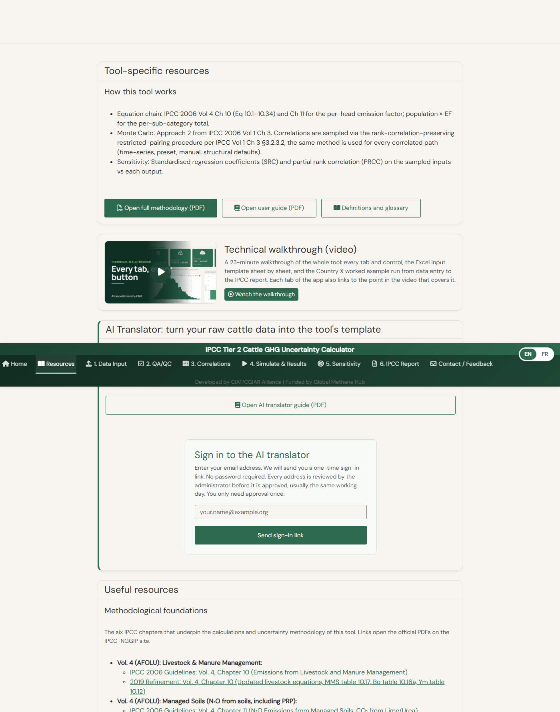{width=100%}

The first thing you see is a sign-in box. You have to sign in before you can use the translator. The translator runs on an AI service that costs money on every run, so access is controlled: we review each request and accept it by email address.

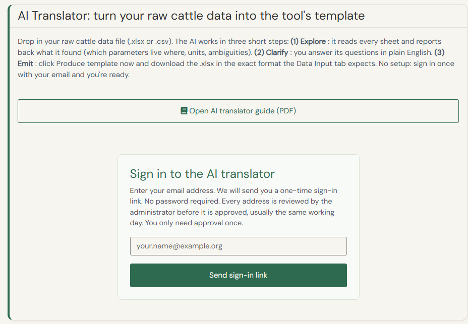{width=100%}

Here is what happens, in order:

1. Type your email address and click **Send sign-in link**.
2. An email arrives within a minute or two. Click the link in it.
3. The first time, the app tells you that your request has been sent to the administrator. We review it and accept your address, usually the same working day.
4. When your address is accepted, you receive a welcome email with a link to the app.
5. Go back to the Resources tab, enter your email again and click the new link. The translator opens.

The link in a sign-in email works for 30 days. Once you have clicked it, your browser stays signed in. You only need a new link if you change browser or clear your browsing data. A private or incognito window forgets you every time, so use a normal window.

When you are signed in, the card shows your email address and an upload box.

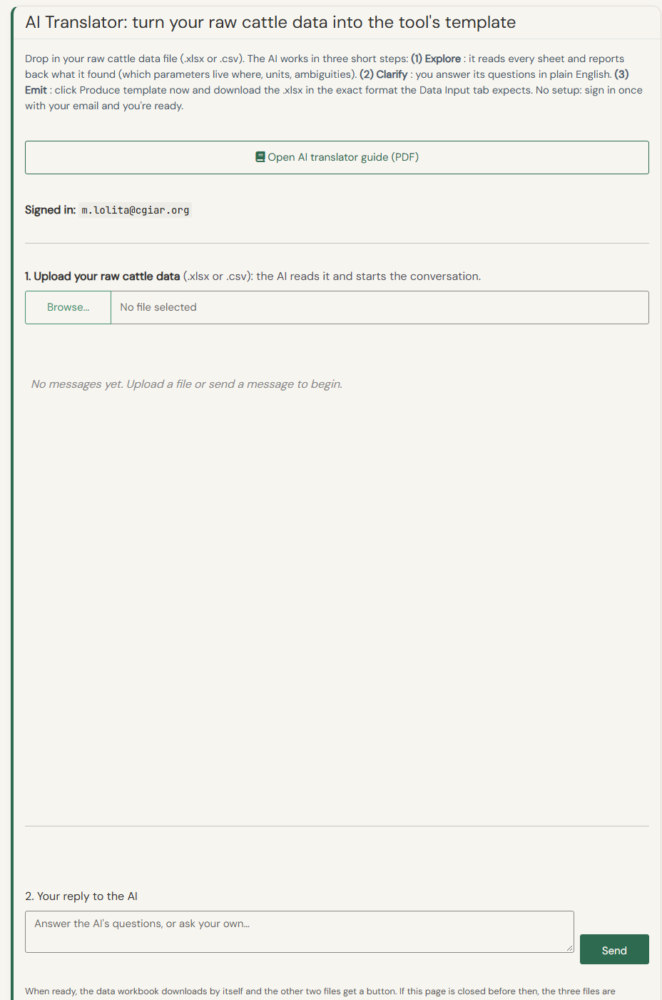{width=100%}

### 2. Uploading your data

Click **Browse** and choose your inventory file. Excel files are accepted, with one or several sheets, and so are CSV files. The file can be up to 8 MB.

The translator reads the file and lists the sheets it found, with a size for each one. Untick the sheets it does not need, such as lookup tables or calculation sheets. Fewer sheets means a faster and cheaper first reply.

You also have a box to give the AI some context, for example "inventory year 2022, national level, milk is in litres". This is optional but it helps.

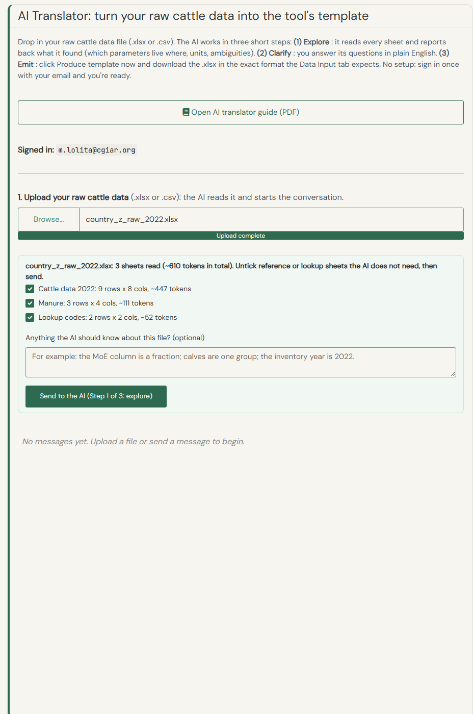{width=100%}

Then click **Send to the AI (Step 1 of 3: explore)**.

### 3. Data exploration

The first thing the AI does is explore your data. It works out what each label means, what the units are, and where something is unclear or inconsistent. After about a minute, it replies with what it found: the sheets, the animal groups, the parameters, and the parameters missing from your file. Click **Show what the AI read from the file** to see the full list, with the sheet, row and column of every value.

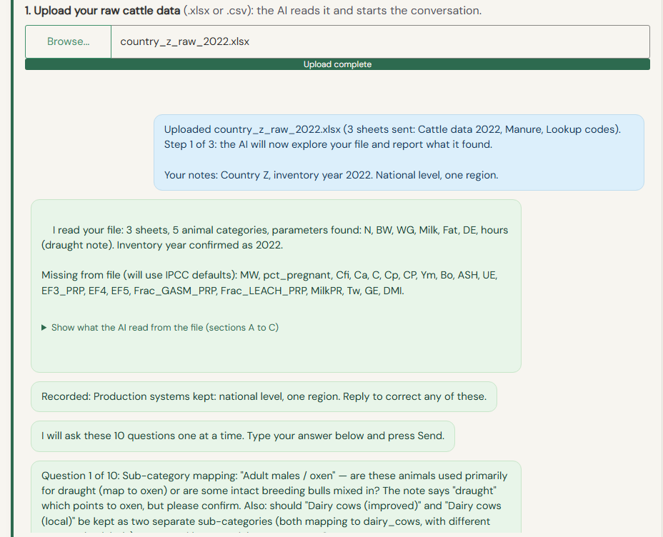{width=100%}

Check this list against your file. If a parameter you have is not in it, say so in your reply.

The AI then asks its questions, to make sure it produces a correct template. The questions come one at a time. Answer each one in the box under the chat and click **Send**. Plain language is fine. You see the next question only after answering the current one. If you do not know the answer, type "skip" and the AI uses the IPCC default.

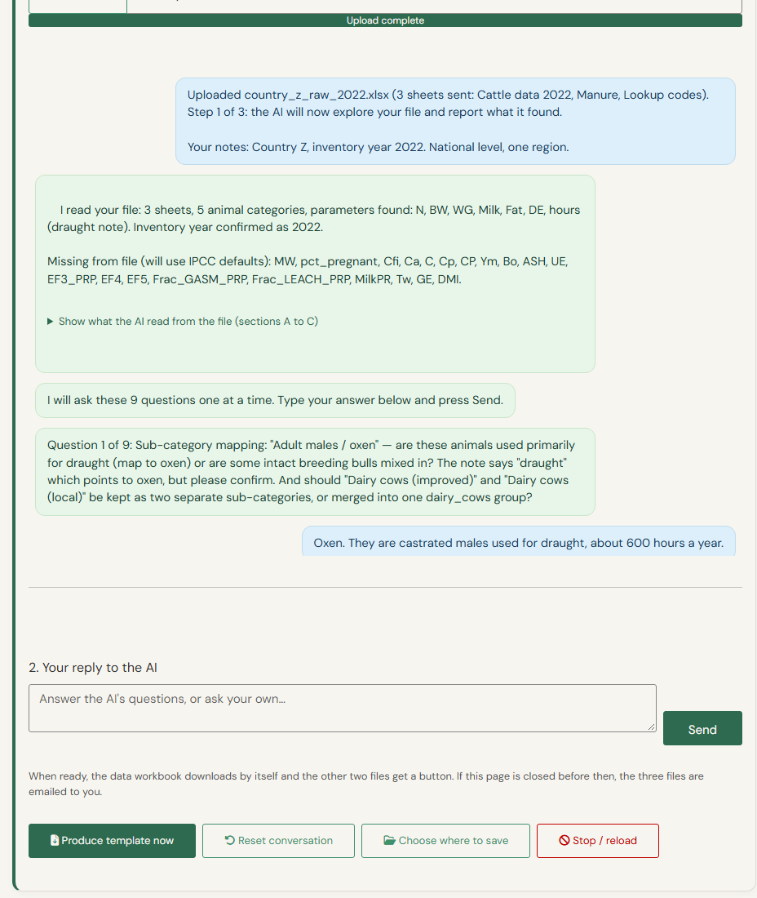{width=100%}

When all the questions are answered (up to about twelve), your answers go back to the AI together, and it thinks again. It replies with a summary and one line starting with **Recorded:** for each decision it has taken from your answers. Read these lines. If one is wrong, reply with the correction.

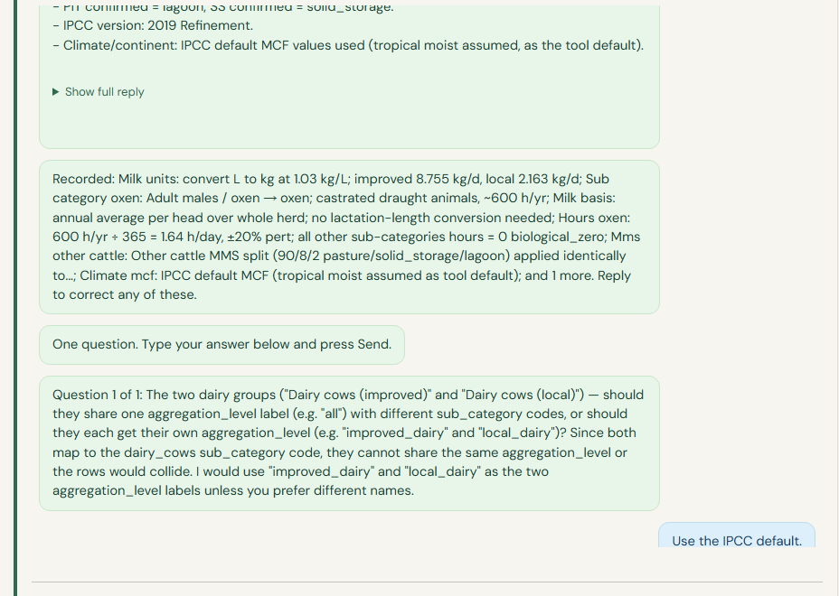{width=100%}

If something is still unclear, the AI asks more questions, and this repeats until everything is clear.

### 4. Producing the template

When you are happy with the AI's answers and everything is clear, click the green **Produce template now** button under the chat.

A pop-up appears and asks where the files should go.

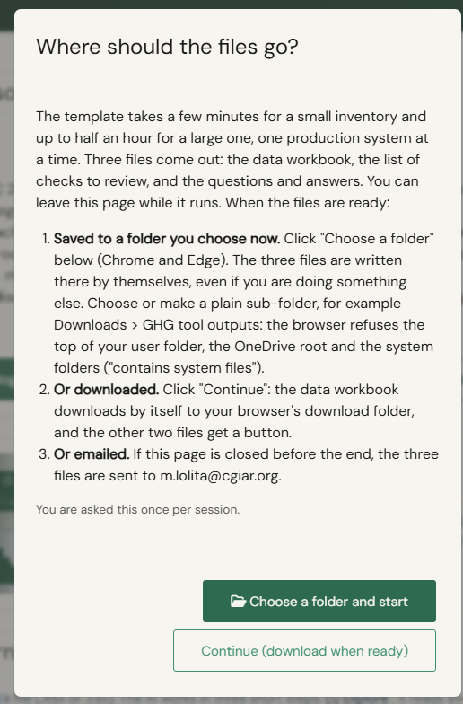{width=100%}

This matters. Producing the template takes time, and the connection to the server drops if the page sits idle for too long. If that happened while the template was being produced, you would lose the result. So you can authorise a folder in advance: create a folder somewhere, for example a sub-folder of Downloads, click **Choose a folder and start**, and give the app access to it. The files are then saved there by themselves, even if you are doing something else. This works in Chrome and Edge.

The other option is **Continue (download when ready)**: the template downloads by itself when it is ready, and the other two files get a button. If the page is closed before the end, the three files are emailed to you.

Then the work starts. A progress bar shows what the AI is doing and how much time is left. This is a heavy task. A small inventory takes a few minutes; a large one can take up to 30 minutes.

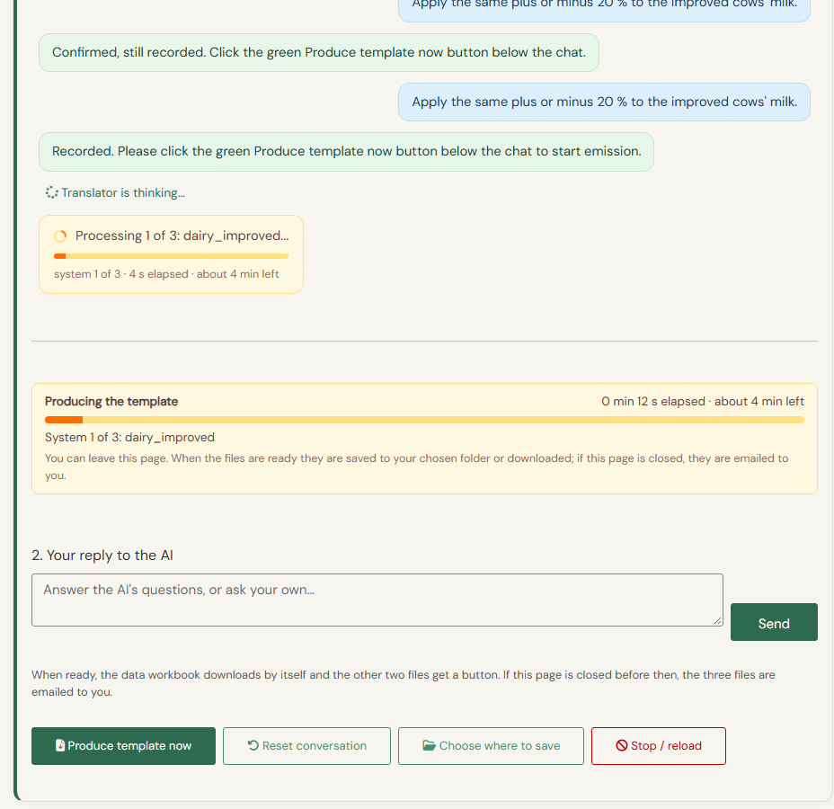{width=100%}

### 5. The outputs

When the work is done, the card shows three download buttons.

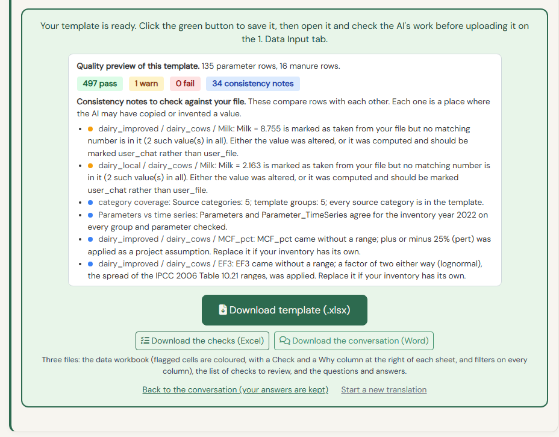{width=100%}

The tool produces three files. Their names carry the country, the year and the time, so you can tell versions apart.

- **The translated template.** The Excel file in the right format for the tool to run.
- **The list of checks.** The points in your data that you have to check.
- **The conversation.** A Word file with the questions the AI asked and your answers, as a record of what was decided.

### 6. Checking the data

The AI translator is not perfect. You are still responsible for checking your data and making sure it is correct. To help, the tool runs checks and points at the exact cells to look at. Examples of what the checks catch:

- a group in your file that is missing from the template;
- a value marked as "from the file" that is not actually in the file;
- a percentage written as a fraction, or the reverse;
- a population counted under two groups;
- manure system shares that do not add up to 100%;
- a value for which the file gave no range, so an IPCC default range was used.

Each point has a level:

- **Fail**: the value would break or distort the simulation. Correct it before running.
- **Warn**: the value looks unusual. Check it, and if it is right, note why in your records.
- **Info**: a note, nothing to correct.

A summary of the checks is shown above the download buttons. In the translated template, the cells concerned are coloured, and each sheet has a **Check** and a **Why** column at the right. The columns have filters, so you can show only the rows with a point to check and read the message. You can also download the full list of checks as a separate Excel file.

Before uploading the template, it is also worth opening the Parameters sheet and looking at the `data_source` column: `user_file` means the value comes from your file, `ipcc_default` means an IPCC default was used, and `biological_zero` means a zero that is correct for that group, such as milk for oxen.

### 7. What to do next

You have several routes.

**Everything looks right.** Go to the **1. Data Input** tab, upload the translated template, and run the calculator.

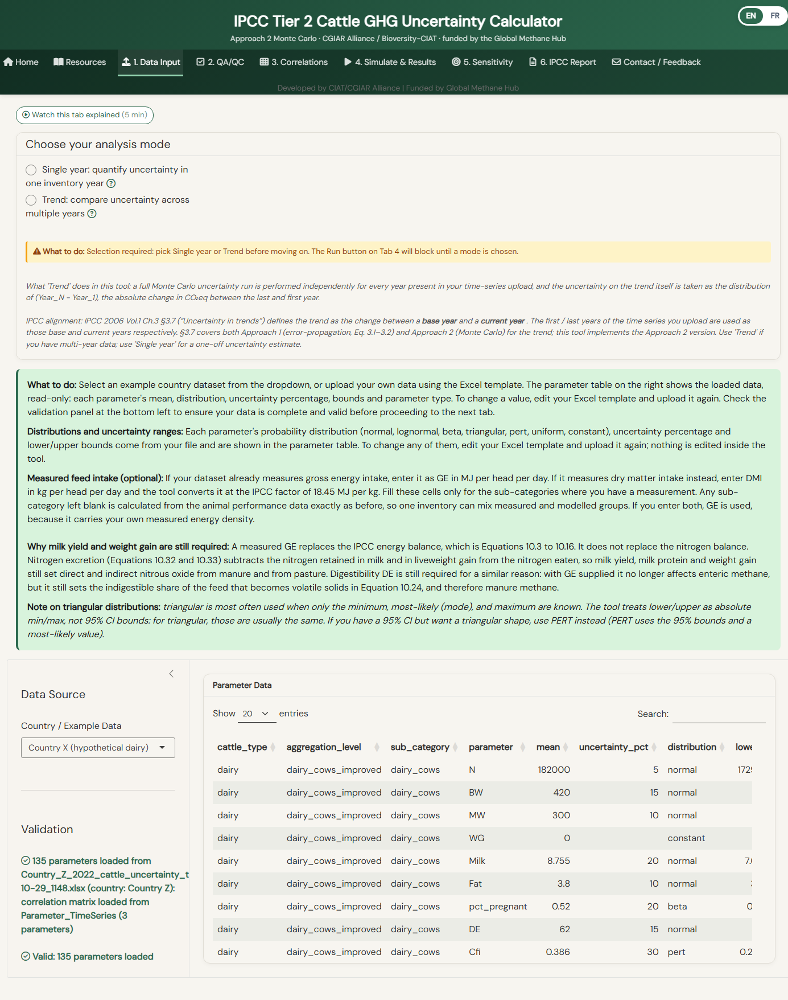{width=100%}

On the **2. QA/QC** tab, every value filled from an IPCC default is listed, so you can replace it with a national value if you have one.

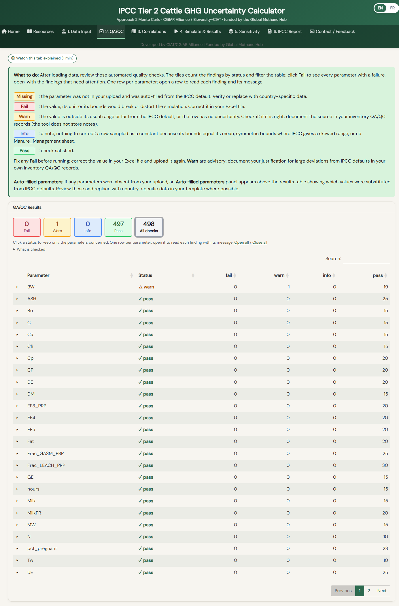{width=100%}

**Something is wrong.** While checking, you may find an error. It can come from the translator, or from your input data. Good practice:

- If your input file is wrong, correct the input file. Then start a new translation with the corrected file.
- If the error is small and easy to fix in the translated template, fix it by hand in Excel. There is no need to run the translator again.
- If the error is more complex, click **Back to the conversation (your answers are kept)**, explain the problem in the box, and click **Produce template now** again. The AI produces the template again with your extra information.

You can also click **Start a new translation** to begin again from scratch.

One conversation makes one template for one country and one year. For a second year or a second country, always start a new translation. Do not continue the old conversation with new data: the names and units agreed for the first file would be carried over without anyone noticing.

## Privacy and operational cost

### Where your data goes

When you upload a file, its contents are sent to the AI service over an encrypted connection. That is how the translation is done, and it is the main thing to know before uploading anything.

A copy of the conversation, with your data and your email address, is then kept in a file on the app server, so that you can close the tab and come back later. It is removed in two cases: when you click **Reset conversation**, and when the server restarts after a period without use. There is no scheduled deletion beyond that, so **Reset conversation is the reliable way to remove it**.

Separately, a usage log records the date, your email address, the AI model and the number of tokens of each call. It holds no file contents. It exists so the administrator can watch the spending.

The AI service applies its own terms to the data it receives. Those are the provider's terms and should be read directly rather than summarised here.

### Cost

The translator runs on an AI account paid for by the GMH project. You are not billed. There is a monthly spending cap. If it is reached, a message says "monthly cap reached, contact administrator", and translations pause until the next month.

### Whether to use it at all

The inventory data the translator handles is generally not sensitive: it is meant for UNFCCC reporting, which is public. If your ministry does not allow sending pre-publication data to an external AI service, do not use the translator. Fill the template by hand instead, with the IPCC defaults given in the user guide.

<div class="related">
### Related material

- [User Guide](../user_guide.pdf), section "AI-assisted data preparation": the same workflow in the printable user guide.
- [Methodology document](../methodology.pdf): the equations, the parameter definitions and the references for everything the translator writes.
- [Find out more: Correlations](correlations.html): the correlation modes of the Simulate tab.

</div>
