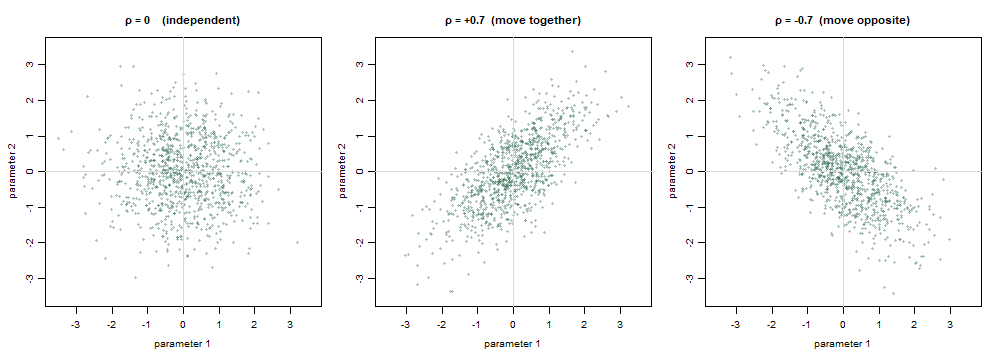
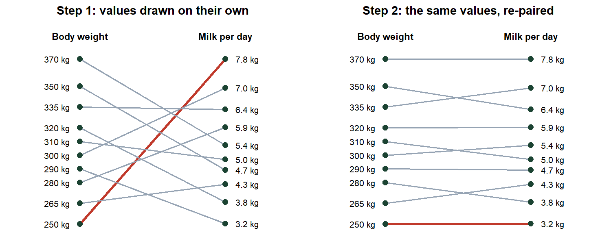
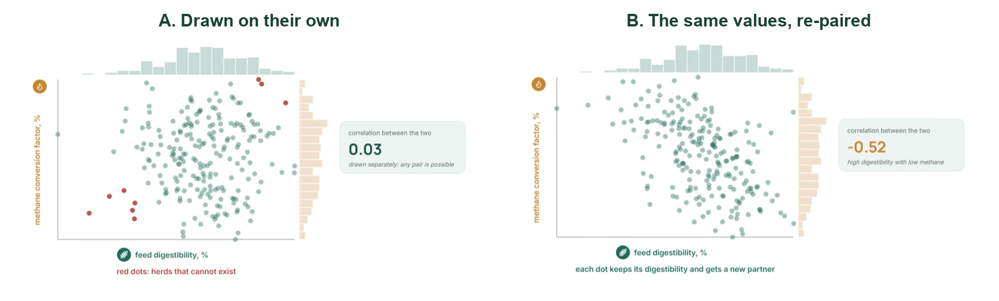
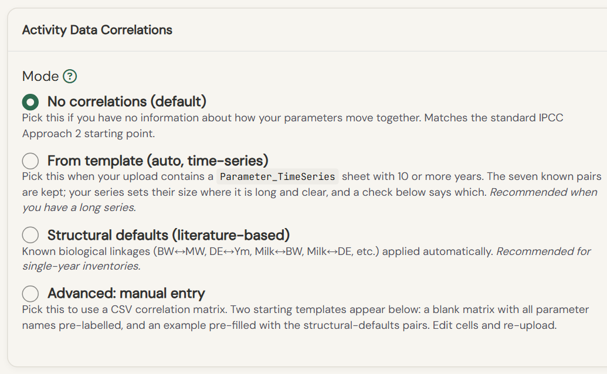
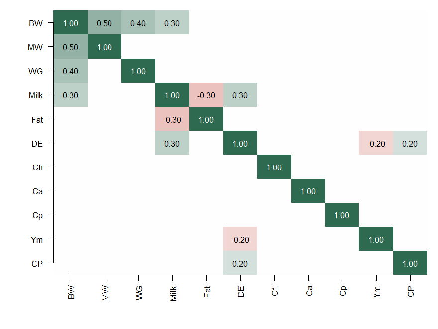
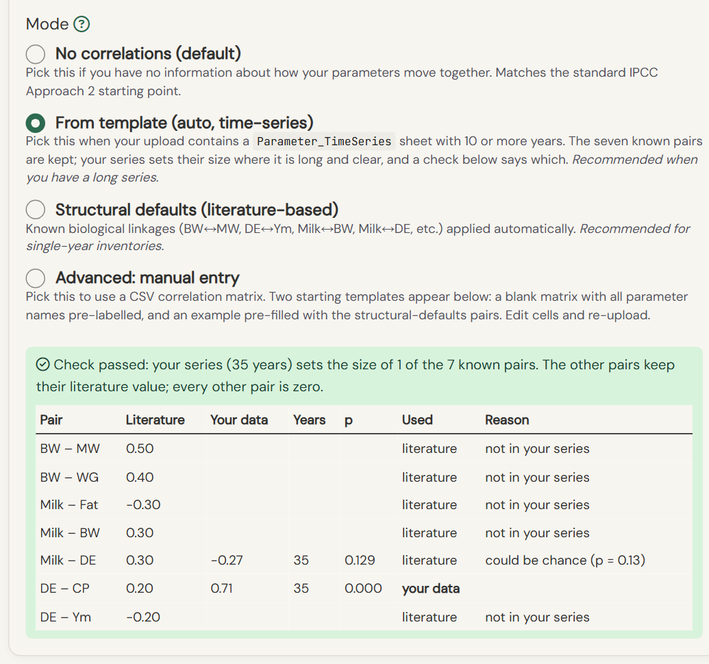
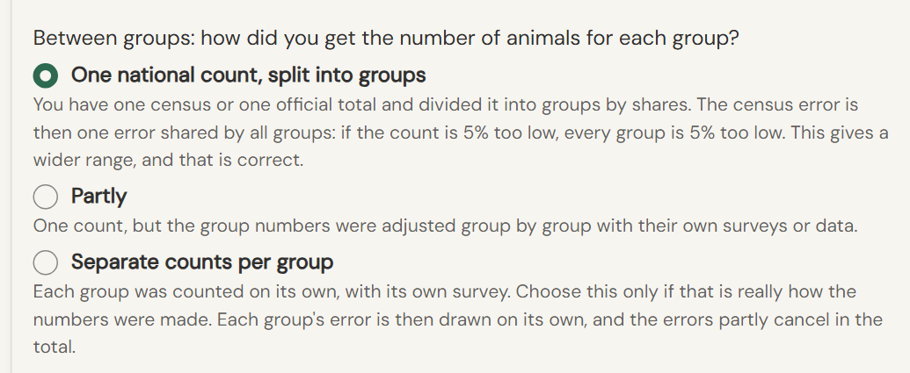

---
output:
  html_document:
    self_contained: true
    css: _shared.css
    theme: null
    highlight: null
    mathjax: null
    includes:
      in_header: _head_correlations.html
    pandoc_args: ["--metadata=title:Correlations between inputs | Cattle GHG Uncertainty Calculator Help"]
params:
  cache_dir: "www/docs/_cache"
---

<!-- 2026-10-30: rewritten from Lolita's edited Word drafts (correlations_guide_v2/v3). The worked example uses
     a real national inventory, unnamed on request; its figures come from C:/tmp/g.R (log
     C:/tmp/shots/guide_grid_2026-10-30.log). The screenshots are from the app of 30 October. -->

This guide explains, step by step, what correlations are and why they matter for your uncertainty analysis. It then shows where to set them in the tool, what each choice means, what each choice changes in the results of a real inventory, and which option to choose for your own data.

## 1. What is a correlation?

Two inputs are **correlated** when they tend to move together. The correlation is **positive** when one input goes up and the other tends to go up as well: heavier cows, for example, tend to give more milk. It is **negative** when one input goes up and the other tends to go down: when cows give more milk, the fat content of that milk tends to be lower. When knowing one input tells you nothing about the other, there is **no correlation**.

The strength of a correlation is a number between −1 and +1. A value of 0 means there is no link. A value of +1 means the two inputs always move together, and −1 means they always move in opposite directions. Most links between livestock inputs are weak to moderate, between 0.2 and 0.5 (or between −0.2 and −0.5).

**Why it matters.** The tool tests thousands of possible combinations of your inputs. If two inputs are linked in reality, but the tool picks their values independently, it builds combinations that do not exist, for example a very light cow with a very high milk yield. Such combinations do not change the average emissions. They change how wide the uncertainty range is.

## 2. Seeing a correlation

Figure 1 shows the same two inputs three times. Each dot is one combination of values: one value of input 1 (across) and one value of input 2 (up). There are 1,000 dots in each panel.

{width=100%}

On the left, there is no correlation: the dots form a round cloud, and a high value of input 1 can come with any value of input 2. In the centre, the correlation is positive: when input 1 is high, input 2 also tends to be high, and the cloud tilts upward. On the right, the correlation is negative: when input 1 is high, input 2 tends to be low, and the cloud tilts downward.

In the three panels, each input has exactly the same values: the same spread on each axis. The correlation does not change the values of either input. It only changes which values come together.

## 3. How the tool takes correlations into account

### 3.1 The Monte Carlo method in a few words

The tool uses the Monte Carlo method. For each input, it picks a value at random within the range you gave; values near your central value come up more often than values near the edges of the range. With these values, it calculates the emissions of your whole inventory. It then repeats this many times, for example 10,000 times, and each repetition is called an iteration. At the end, it has 10,000 possible results, and their spread shows how uncertain your emissions are.

### 3.2 The problem

When each input is picked on its own, the pairs are random. In Figure 2 (left), the lightest cow (250 kg) is paired with the highest milk yield (7.8 kg per day). In a real herd, that pair is unlikely.

### 3.3 The solution: re-pairing the values

After drawing all the values of each input, the tool **re-pairs** them. It keeps every value, but changes which values go together, so that the pairs follow the link you chose. In Figure 2 (right), the 250 kg cow is now paired with 3.2 kg of milk per day.

{width=100%}

Figure 3 shows the same thing with many iterations, for feed digestibility (DE) and the methane conversion factor (Ym). The bars along each axis show the values of each input. They are the same in both panels: each input keeps exactly the same values, so its average and its range do not change. Only the pairs change. Drawn on their own (A), the two inputs show no link, and some dots are herds that cannot exist, shown in red. Re-paired (B), high digestibility comes with a low methane conversion factor, as in real herds.

{width=100%}

This way of re-pairing is called the Iman–Conover method. It is the method described in the IPCC Guidelines (IPCC 2006, Volume 1, Chapter 3).

## 4. The correlation choices in the tool

All the choices are on **Tab 3, Correlations**. The tab has two cards. The first, **Activity Data Correlations**, asks whether some of your inputs move together. The second, **Animal numbers (N): where do they come from?**, asks how your animal numbers were made.

### 4.1 Do some inputs move together?

The first card offers four options (Figure 4). The text under each option in the tool repeats what it does.

{width=100%}

**No correlations.** Every input is drawn on its own, and no pair is re-paired. This is the starting point of the IPCC method (Approach 2). Choose it when you have no information about links between your inputs.

**Structural defaults.** The tool applies seven links that are known from the livestock literature, and draws every other input on its own. Each link joins two inputs that are calculated together in the IPCC equations, or that change together in real herds: heavier cows give more milk, for example. The direction of each link comes from the IPCC equations and from published studies. Its size was set by the project team from the studies listed in the table below. IPCC publishes no values for these links. Choose this option when your inputs come from data in which these biological links hold, for example one survey of the same animals, and you have no long series of your own.

| Link | Value | Source |
|----------------|------|--------------------------------------|
| Body weight and mature weight | +0.50 | IPCC 2006, Eq. 10.6; IPCC 2019, Table 10A.2 |
| Body weight and weight gain | +0.40 | IPCC 2006, Eq. 10.6; Mehrban et al. 2021 |
| Milk yield and milk fat | −0.30 | Boujenane 2002; Nistor et al. 2011; IPCC 2019, Table 10A.1 |
| Milk yield and body weight | +0.30 | IPCC 2019, Table 10A.1; Berry and Evans 2022; Berry et al. 2003 |
| Milk yield and digestibility | +0.30 | NRC 2001; IPCC 2019, Table 10A.1 |
| Digestibility and crude protein | +0.20 | INRAE-CIRAD-AFZ feed tables 2018; Feedipedia |
| Digestibility and methane conversion | −0.20 | IPCC 2019, Table 10.12; Ramin and Huhtanen 2013; Johnson and Johnson 1995 |

When you select this option, the right side of the card shows the links as a grid (Figure 5). Green cells are positive links, red cells negative ones, and white cells no link. Hover over a cell in the tool to read its source.

{width=60%}

**From template.** This option starts from the same seven links, and checks them against your own data. It can be used when your Excel template has a Parameter_TimeSeries sheet with 10 years or more. For each of the seven links, the tool looks at how the two inputs moved together over the years in your series. Where your data show a clear link, the run uses the size found in your data. Otherwise it keeps the literature value. The tool never adds a link that is not one of the seven.

Using your own data is better than using the literature, but only when the data really show a link. Two things can mislead. With only a few years of data, two inputs can seem to move together by chance. And two national values can both rise over the years, for example as the sector grows, without their errors being linked. This is why the tool runs a check on each link before using your data. It first checks that both inputs are in your series, and that the series has at least 10 years. It then calculates the probability that the link is due to chance (p), which must be below 5%. Finally, it checks that your data show the link in the same direction as the literature. Only when all four checks pass does the run use the value from your data; otherwise it keeps the literature value. To avoid being misled by a shared trend, the tool compares the change from one year to the next, not the values themselves.

The result of the check appears in a table under the option (Figure 6). Each row is one of the seven links. "Literature" gives the value from the literature and "Your data" the value found in your series, left blank when the two inputs are not both in your series. "Years" is the length of your series, and "p" the probability that the link in your data is due to chance. "Used" says which value the run uses, and "Reason" explains why the literature value was kept.

{width=100%}

In the example inventory of section 5, the series has 35 years. Two links pass all four checks and take the value from the data: milk yield and body weight (+0.55 in the data, +0.30 in the literature; p below 0.001) and digestibility and crude protein (+0.79 against +0.20; p below 0.001). Two links are not clear enough: body weight and mature weight (−0.27, p = 0.12) and milk yield and digestibility (−0.16, p = 0.37), the second also in the opposite direction to the literature, so both keep the literature value. Two links cannot be tested because one of the two inputs does not vary in the series (weight gain, milk fat), and one because the methane conversion factor is not in the series. Figure 6 shows the table as the tool displays it, for an earlier version of the same file.

**Advanced: manual entry.** This option lets you give your own table of correlations, for example from a study of your own herds. When you select it, two templates appear below the option. The first is a blank table with the names of all your inputs already in its rows and columns. The second is the same table filled with the seven structural-default links, as a starting point. Download one, fill it in Excel with values between −1 and +1 (the diagonal stays at 1), save it as CSV, and upload it. An input missing from your table is drawn on its own. Choose this option only if you have measured correlations.

**To see the effect on your own inventory**, tick "Compare with/without correlations" on Tab 4 before you run. The tool then runs twice, once with your choice and once without any correlation, and shows both results side by side.

### 4.2 Animal numbers between groups

The second card asks how you got the number of animals in each group (Figure 7). The question behind it is simple: if one number is wrong, which other numbers are wrong with it?

{width=100%}

Choose **One national count, split into groups** when your group numbers come from one census or one official total, divided into groups by shares. If that count is 5% too low, every group is 5% too low at the same time, so the errors add up in the total. Choose **Partly** when your numbers come from one total, but some group numbers were then adjusted with their own surveys or data. Choose **Separate counts per group** only when each group was really counted with its own survey. Some groups will then be too high and others too low, so the errors partly cancel in the total.

## 5. Example: what the choices change

The example is a national cattle inventory with 27 groups of animals: dairy and other cattle, in five production systems, about 6.4 million animals in the inventory year 2024. The country gave its own uncertainty range for most inputs, and a series of 35 years for the inputs that change over time. Each run used 4,000 iterations and the same starting point for the random draws, so the only difference between two runs is the choice tested. The total emissions are 15.4 million t CO~2~e in every run; the choices change only the uncertainty around that total.

The table crosses the two cards of Tab 3: each row is an answer to "Do some inputs move together?", each column an answer to "Animal numbers between groups". The cell is the uncertainty of the total, as ± half of the 95% range.

| Do some inputs move together? | Separate counts per group | Partly | One national count, split into groups |
|---------------|-----------|-----------|-----------|
| No correlations | ±37.8% | ±46.7% | ±52.3% |
| Structural defaults | ±37.3% | ±45.2% | ±50.8% |
| From template | ±35.8% | ±44.0% | ±49.7% |

**Reading the rows: the links between inputs change the uncertainty by one to two points.** In this inventory most of the uncertainty comes from the animal numbers and from feed digestibility, and the seven links are weak to moderate. Several of them pull in opposite directions. Heavier cows give more milk, and both raise the emissions, so that link widens the range. Higher digestibility comes with a higher crude protein content; the first lowers the methane, the second raises the nitrous oxide, so that link narrows the range. Here the second effect is the larger one, and the range narrows a little. In another inventory the balance can go the other way; a change of a few points in either direction is what to expect from this card.

"From template" gives the narrowest range because the check (section 4.1) kept two links from the country's own series, both stronger than the literature values: milk and body weight at +0.55 instead of +0.30, and digestibility and crude protein at +0.79 instead of +0.20. The other five links kept their literature values: two were not significant, two had no variation in the series, and one input (the methane conversion factor) is not in the series.

**Reading the columns: how the animal numbers were made changes the uncertainty by 15 points.** With separate counts, the 27 groups each have their own error. Some are too high and some too low, so the errors partly cancel in the total. With one national count split into groups, a count that is too low makes every group too low at the same time. Nothing cancels, so the range is much wider. Neither answer is better than the other: the right one is the one that describes how your numbers were made.

These are the results expected from the method: the column effect is large because the animal numbers are the largest source of uncertainty and the column decides whether their errors add up; the row effect is small because the links are weak and partly cancel.

## 6. Which option to choose

The right option is the one that describes how your data were made, not the one that gives the narrowest range. Two short tables to decide.

**Do some inputs move together?**

| Your situation | Option |
|---|---|
| You have no information about links between your inputs, or your inputs come from different sources (a survey for the weights, a feed table for the digestibility, a default for the methane factor) | No correlations |
| Your inputs come from data in which the biological links hold, for example one survey of the same animals, and you have no long series | Structural defaults |
| Your template has a Parameter_TimeSeries sheet with 10 years or more | From template: the tool checks each link against your series and uses your value where the link is clear |
| You have measured correlations from a study of your own herds | Advanced: manual entry |

**Animal numbers between groups**

| Your situation | Option |
|---|---|
| One census or one official total, divided into groups by shares | One national count, split into groups |
| One total, but some groups adjusted afterwards with their own surveys or data | Partly |
| Each group counted with its own survey | Separate counts per group |

If you are not sure, "No correlations" and "One national count, split into groups" are the cautious choices: they do not narrow the range on the strength of a link you cannot support.
