```{r setup, include=FALSE}
knitr::opts_chunk$set(echo = FALSE, warning = FALSE, message = FALSE)
```

\vspace{1cm}

\begin{center}
% Logo paths reference filenames only (no www/ prefix). LaTeX picks the
% correct directory via \graphicspath in the header-includes (set to
% search both ../www/ when the .tex compiles from doc/ and ./www/ when
% it compiles from project root). \IfFileExists below now resolves the
% same way, so the logos render regardless of where the build runs.
\includegraphics[height=1.6cm]{alliance_logo.png}\hspace{1.8cm}%
\includegraphics[height=1.6cm]{climate_action_logo.png}\hspace{1.8cm}%
\includegraphics[height=1.6cm]{gmh_logo.png}\par\vspace{12pt}%
\textcolor{cgiargreen}{\rule{14cm}{1.5pt}}\\[6pt]
\textcolor{cgiargreen}{\large\textbf{Version 1.0}}\\[4pt]
\textcolor{darkgrey}{Developed under the Global Methane Hub initiative}\\[4pt]
\textcolor{cgiargreen}{\rule{14cm}{1.5pt}}
\end{center}

\newpage

# Overview

## What this tool does

Cattle are a major source of methane. In many countries their emissions are still growing. Countries can estimate these emissions more accurately with the IPCC Tier 2 method, which uses national data on the animals, their feed and their manure. The Paris Agreement transparency rules encourage countries to use these higher tier methods and to keep improving their inventories.

Every estimate has an uncertainty: the true value may be somewhat higher or lower than the number reported. The IPCC asks countries to say how large this uncertainty is. This is good practice whenever a higher tier method is used. It is also useful in itself: once you know which inputs drive the uncertainty, you know where better data would improve the inventory most.

Many countries cannot do this analysis today. The Tier 2 equations are complex, so the uncertainty has to be estimated with a Monte Carlo simulation. Inventory compilers and livestock experts rarely have the statistical training for this. The commercial software that does it is expensive, and the free options do not show which inputs drive the uncertainty.

This tool fills that gap. It is free, it runs in a web browser, and it does the Monte Carlo simulation for you. In short:

1. You give the tool your Tier 2 inputs (animal numbers, weights, milk yields, emission factors and so on), each with an uncertainty range.
2. The tool draws thousands of possible values for every input, within the ranges you gave, and runs the full IPCC Tier 2 calculation for each set of draws.
3. It reports the range in which your emissions most likely lie (the 95% confidence interval), shows which inputs matter most, and gives you the numbers in the format of IPCC Table 3.3 for your inventory report.

The method is IPCC Approach 2 (Monte Carlo), as described in the 2006 IPCC Guidelines, Volume 1, Chapter 3.

The home page of the tool shows the same journey, one tab at a time (Screenshot 1). You work through the tabs from left to right, and each tab starts with a short box telling you what to do there.

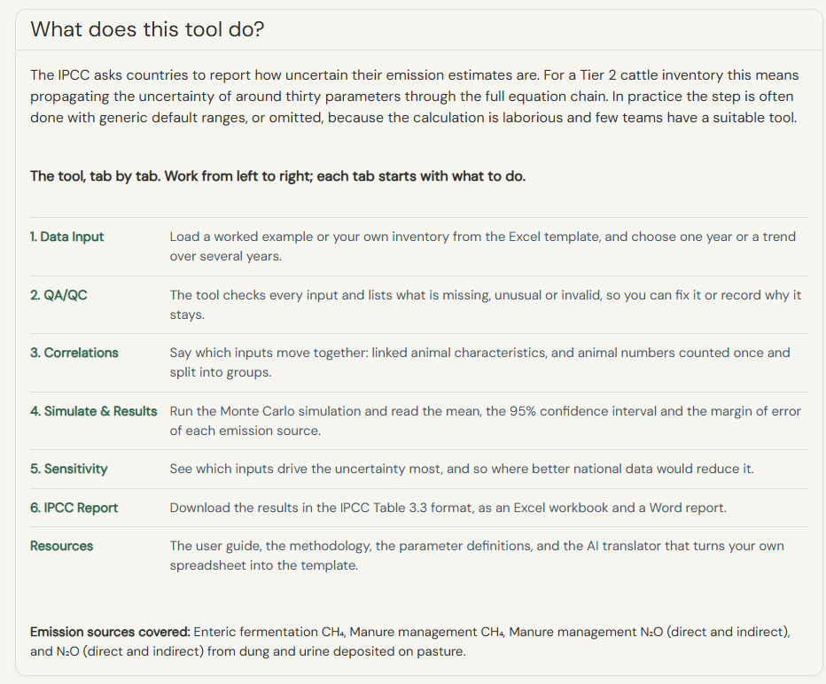{width=100%}

*Screenshot 1. The home page lists every tab with one sentence on what it does.*

## Who this tool is for

This tool is for national inventory practitioners who:

- are already doing, or have recently completed, a Tier 2 cattle GHG inventory;
- have at least rough estimates of the uncertainty of their main inputs;
- need to report an uncertainty range in their national inventory report.

You need to know the IPCC Tier 2 method and some basic statistics. You do not need any experience with Monte Carlo simulation. It helps to know what a probability distribution is, and this guide explains the terms as they come up.

\newpage

# Preparing your data

## What you need before you start

Before opening the tool, you need the right data to run it. Four kinds of input are needed.

1. **Activity data.** For each animal sub-category: the number of animals (N), the body weight (BW), the daily weight gain (WG), the milk yield (for cows), the milk fat content, the digestibility of the feed (DE), and the other Tier 2 inputs your inventory uses.

2. **Uncertainty ranges.** For each input, an estimate of how uncertain it is. This is usually given in one of two ways:
    - a percentage (for example ±20%, meaning the true value is very likely within 20% of the number you give), or
    - a lower and an upper value.

    The tool has a default range for only a few IPCC coefficients: Ym, Bo, Cfi, Ca, C, Cp, the pasture N~2~O factors, and some manure factors. For every other input, the range should come from your own data. If one is missing, the tool uses a placeholder range so that it can run. A placeholder has no published source: the tool warns you about it, and lists it in the report and the exports. Replace it with your own range.

3. **Manure management fractions.** The share of manure handled in each management system (for example pasture, solid storage, liquid storage).

4. **Emission factors and other coefficients.** If your inventory uses country-specific emission factors (for example EF3 or EF4) or country-specific values for other coefficients (for example C, Ca, Cp or Frac_GasMS), you need those values with their uncertainty. If your inventory uses the IPCC default values, the tool fills them in for you.

## AI-assisted data preparation

Your data will probably not be in the format the tool needs. The tool has an AI translator that converts it for you. It is a small chat panel on the Resources tab. You upload your file, the AI reads it and asks you a few questions, and it produces a filled template that you can download and load into the tool.

The translator works in three steps: it explores your file, it asks you to clarify what is unclear, and it writes the template. The [AI translator guide](https://mlolita26.shinyapps.io/cattle-ghg-uncertainty/ai_translator_guide.pdf) explains each step with screenshots.

The translator maps your columns to the template. It does not decide on your numbers for you, so please take a few minutes to check its work. Always do two things afterwards:

- compare the main numbers (animal numbers, body weights, milk yields) with your original file;
- read the checks. The translator writes its own checks file next to the template, and the QA/QC tab checks the template again once you load it. Any value the translator took from an IPCC default is marked in both places.

\newpage

# Loading your data (Tab 1: Data Input)

When you open Tab 1, nothing is loaded yet. You make two choices: first the type of analysis, then the data.

## Single year or trend?

The first card asks what you want to analyse (Screenshot 2). This choice changes what the tool calculates, so it is worth a moment.

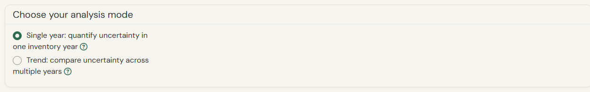{width=75%}

*Screenshot 2. The first choice on Tab 1: one year, or a trend over several years.*

- **Single year.** The tool calculates the uncertainty of one inventory year: the total emissions of that year, their 95% confidence interval and the uncertainty of each emission source. This is what IPCC Table 3.3 asks for a given year. Choose it when you report one year, or when you are trying the tool for the first time.
- **Trend.** The tool calculates the emissions and their uncertainty for every year of your time series, and also the uncertainty of the change between two years: the base year and the year you report (year t). You choose these two years in the results; by default they are the first and the last year of your series. Choose this when you need the trend columns of Table 3.3. It needs a Parameter_TimeSeries sheet in your file, or one of the example datasets.

Think of it this way: a single-year run answers "how sure are we of this year's total?", and a trend run also answers "how sure are we that emissions went up (or down) since the base year?". The second question is often easier to answer than you would expect, because an error that is the same in both years cancels out when the two years are compared. The correlation choices on Tab 3 tell the tool which errors are the same from year to year.

## Using the example datasets

Two example datasets let you try the tool without your own data:

- **Country X (hypothetical dairy)**: a fictional smallholder dairy system with one group of dairy cows, 16 parameters, and a made-up 5-year time series.
- **Country Y (hypothetical pastoral)**: a fictional semi-arid pastoral beef system with one group of breeding cows, 16 parameters, and a made-up 5-year time series.

Pick one in the "Country / Example Data" list. The data loads at once.

## The parameter table

Once data is loaded, a table appears on the right (Screenshot 3). It lists every parameter with its mean value, its distribution, its uncertainty percentage, its lower and upper bounds and its type. Above it, a yellow box lists any parameter that was missing from the file and filled with its IPCC default.

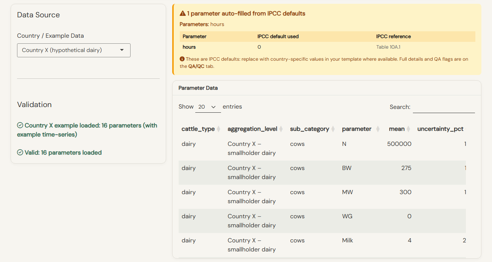{width=100%}

*Screenshot 3. Country X loaded: the data source on the left, the parameters on the right, and the one parameter filled with its IPCC default.*

The table is read-only: the values come from your file. To change a value, edit your Excel file and upload it again. This is on purpose: always correct your source file first, so that the file and the results stay consistent.

## Uploading your own data

Follow these steps if you want to fill in the template yourself. If you would rather let the AI translator prepare it from your own spreadsheet, see the [AI translator guide](https://mlolita26.shinyapps.io/cattle-ghg-uncertainty/ai_translator_guide.pdf).

**Step 1: Choose an IPCC Guidelines version.** In the "Country / Example Data" list, pick "Custom Upload". Then pick the IPCC version your inventory follows:

- **IPCC 2006**: the eight original manure management systems. Choose this if your inventory follows the 2006 Guidelines.
- **IPCC 2019 Refinement**: four more manure management systems (anaerobic digester, aerobic treatment, covered or compacted solid storage, burned for fuel), with the updated emission factors and nitrogen excretion equations. Choose this if your inventory follows the 2019 Refinement.

The template you download only offers the manure systems that exist in the version you picked.

**Step 2: Download and fill in the template.**

1. Click "Download Blank Template" to get the Excel workbook. ("Download Template with Example" gives the same workbook filled with example values, if you like to see one first.)
2. Fill in the **Parameters** sheet: one row per parameter and per animal sub-category.
3. Fill in the **Manure_Management** sheet if you include the manure N~2~O sources.
4. Optional: fill in the **Parameter_TimeSeries** sheet if you want a trend analysis, or want the tool to size the correlations from your historical data.
5. Save the file as .xlsx and upload it with the file picker.

\newpage

# Reviewing data quality (Tab 2: QA/QC)

## What the QA/QC checks do

The QA/QC tab checks every parameter you loaded and tells you if something looks wrong (Screenshot 4). Each parameter gets one of five statuses. The tiles at the top count them; click a tile to see only those parameters. Open a row to read each finding and its message.

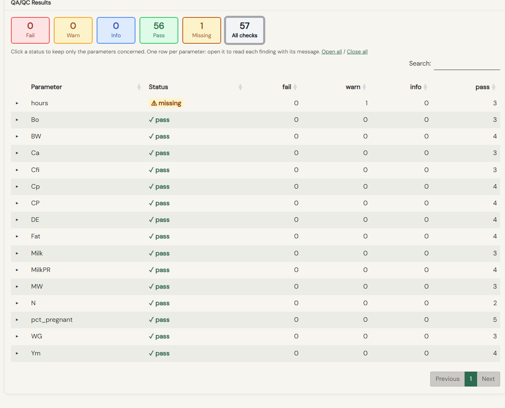{width=90%}

*Screenshot 4. The QA/QC tab for Country X: everything passes, and one parameter is marked Missing because it was filled with its IPCC default.*

- **Pass** (green). The value, its unit and its bounds are fine. Nothing to do.
- **Info** (blue). A note, nothing to correct. Example: a parameter whose lower and upper bounds equal its mean is treated as a fixed value. The simulation can run.
- **Warn** (amber). The value is unusual, or something is missing that the tool can work around. Examples: a body weight far from the IPCC default for that animal class; a digestibility outside its usual range; an input with no uncertainty range in your file and no published default, so a placeholder range is used. The simulation can run. Check the value. If it is correct for your country, keep it and note the source in your inventory report. If it is a mistake, correct it in your file.
- **Fail** (red). The value would break or distort the calculation. Examples: bounds that do not contain the mean; a percentage entered as a fraction (DE = 0.65 instead of 65); a fraction entered as a percentage (pct_pregnant = 52 instead of 0.52). The simulation cannot run until every Fail is corrected.
- **Missing** (grey). The parameter was not in your file. The tool filled it with the IPCC default and tells you which value it used. The simulation can run. Check that the default makes sense for your country. If you have a national value, add it to your file.

Make every correction in your Excel file and upload it again on Tab 1. The simulation then uses the values in your file, and the reports document them as such.

\newpage

# Correlations (Tab 3: Correlations)

This chapter is the longest in the guide, because correlations are the least familiar part of an uncertainty analysis. Take it slowly; the ideas are simpler than the word suggests. If you would like more examples and pictures, the topic page [Correlations: find out more](https://mlolita26.shinyapps.io/cattle-ghg-uncertainty/docs/correlations.html) compares every option on the two example datasets and lists the common mistakes. The same page opens from the green "Find out more" link on Tab 3.

## Why correlations matter

Two inputs are correlated when their errors tend to go together: when one is overestimated, the other tends to be overestimated too (a positive correlation), or underestimated (a negative one). If the tool ignored a real correlation, it would let the two errors cancel each other by chance, and it would report a range that is too narrow, or sometimes too wide.

Two different things are called "correlation" in the tool. They matter to very different degrees.

**Between parameters, within one group.** Some inputs are linked. For example, heavier animals tend to give more milk. If the tool ignores such a link and draws the two values independently, the uncertainty of the total can be a little off. For most Tier 2 inventories this effect is small, a few percentage points, and ignoring it is an acceptable simplification. The IPCC recommends including known correlations where they exist. You choose these links on the first card of Tab 3.

**Between groups, for the same parameter.** This one is not small. If several of your groups use the same number for a coefficient, because it comes from one IPCC default or one regional study, that is a single estimate used many times. If it is wrong, every group is wrong in the same direction at once, and nothing cancels out. The tool therefore draws such a value once per iteration for all the groups that use it. Groups with their own value are drawn separately. You do not tick anything for this: the tool reads the values in your file and does it every time. In the tornado chart a shared value appears as one bar, for example "DE = 52.8 (extensive beef, 6 groups)".

Why this matters: if each group drew its own value instead, the errors would partly cancel and the reported uncertainty would shrink the more finely the inventory is split. On a national inventory with 32 groups that we tested, the 95% margin of error was 32.5% with shared draws and 23.7% with separate draws; cutting the same herd into 128 groups left the first at 30% and took the second down to 11.5%, with no change in the data. The shared figure is the right one, and it is what the tool reports. The IPCC 2019 Refinement (Volume 1, Chapter 3) makes the same point: sub-categories "can be highly correlated, because either the AD are derived from the same source or the EFs have parameters in common".

## The correlation options at a glance

Here is every correlation choice in one place. Some are always on, some you choose, and some appear only for a trend.

| Setting | Where | When it is available | What the tool does |
|---|---|---|---|
| Shared values between groups | Nothing to set | Always | A value used by several groups is drawn once per iteration for all of them. |
| Links between inputs: **No correlations** (default) | Tab 3, first card | Always | Every input is drawn on its own. |
| Links between inputs: **Structural defaults** | Tab 3, first card | Always | Seven known links (weight, milk, digestibility and so on) are applied with values from the literature. |
| Links between inputs: **From template** | Tab 3, first card | When the file has a Parameter_TimeSeries sheet | The same seven links, sized from your own series when the series is long and clear. |
| Links between inputs: **Manual matrix** | Tab 3, first card | After you upload a matrix | The links and values you give. |
| Animal numbers (N) between groups | Tab 3, "Animal numbers" card | Always | One count split into groups (one shared error), partly, or separate counts (independent errors). |
| Animal numbers (N) between years | Tab 3, "Animal numbers" card | Trend only | One census carried over the years, a census every few years, or a new survey every year. |
| Emission factors and coefficients between years | Tab 3, "Animal numbers" card | Trend only | The same factors every year, factors revised every few years, or new factors every year. |

An option you cannot use yet is greyed out, with a short note saying why. For example, "From template" is greyed out when your Parameter_TimeSeries sheet is empty, and "Advanced: manual entry" needs a CSV file first. The two trend rows appear only when you chose Trend on Tab 1.

## How the Monte Carlo simulation uses these choices

It helps to picture what happens during a run. One iteration is one possible version of your inventory: the tool picks one value for every input, within its range and with its distribution, and computes the emissions with the full Tier 2 equations. It then does this again, thousands of times. The spread of the thousands of totals is your uncertainty.

The correlation choices only change *which values are picked together* in one iteration. They never change the range or the distribution of an input, and they do not change the mean emissions.

- **Shared values.** A value used by several groups is picked once in each iteration, and that one pick goes to all the groups that use it.
- **Links between inputs.** The tool first picks all the values of each input on their own. It then re-pairs them across the iterations, so that, for example, the heavier body weights tend to sit in the same iterations as the higher milk yields. Every value is kept; only the pairing changes. Statisticians call this a rank correlation, and it is the method the IPCC describes for Approach 2.
- **Animal numbers between groups.** With "one national count", the error of the count is one error per iteration, applied to every group: in an iteration where the census is 4% too low, every group is 4% too low. With "separate counts", each group gets its own error. "Partly" is in between.
- **Between years (trend).** For the animal numbers and for the emission factors, the tool decides how much of one year's error is carried into the next. "The same every year" keeps the same error in every year of the iteration; "a new one every year" draws a fresh error each year; the middle option links each year's error to the previous year's (with a correlation of 0.7), so an error fades slowly over the years. An error kept from year to year cancels when two years are compared, which is why it lowers the uncertainty of the trend.

## Quick guide: which option do I pick?

For the first card (links between inputs):

- You have ten or more years of national data in your Parameter_TimeSeries sheet: pick **From template (auto, time-series)**.
- You have no long time series, but you want the known biological links (weight, milk, digestibility): pick **Structural defaults**.
- You have your own correlation matrix from a study or from expert judgement: pick **Advanced: manual entry**.
- None of these: keep **No correlations**. This is the default. It is simple to explain and defend.

For the "Animal numbers" card, answer the questions as honestly as you can from how your numbers were really produced; the sections below explain each choice.

## What change in the result should I expect?

The central estimate (the mean emissions) stays the same whichever option you pick. What changes is the width of the 95% uncertainty interval. For a typical single-year cattle inventory:

- **No correlations**: the baseline. Every parameter is drawn independently.
- **Structural defaults**: the interval changes by about one percentage point or less on the examples (Country X 25.0% to 25.3%). The effect is small because the preset links only 7 pairs out of about 78 possible pairs, with moderate values.
- **From template (auto, time-series)**: the same seven pairs as the structural defaults, with the size of a pair taken from your own series where the series is long and clear. The effect is therefore close to the structural defaults.
- **Advanced: manual entry**: depends entirely on what you upload. Strong correlations on parameters with wide uncertainty can move the interval by 20% or more, in either direction.
- **Animal numbers between groups**: this one can matter a lot when your inventory has many groups, because one census error shared by all the groups does not cancel. On a national inventory with 32 groups that we tested, the total margin of error was 32.5% with separate counts and 47.1% with one count split into groups.

If you select correlations and the result barely changes, that is usually expected, not a bug. The IPCC calculation multiplies about 13 parameters together, which dilutes the effect of any single pair. Some links can even narrow the interval a little, because they pair inputs whose effects on emissions pull in opposite directions. The Methodology document explains the mathematics.

**Seeing the effect on your own inventory.** For a single-year run, Tab 4 has a box "Compare with and without correlations". When it is ticked, the tool also runs your inventory with nothing ticked on Tab 3, and, when you chose both links and an animal-number option, once more with the links only. The results then show one bar per level, so you can see what each of your choices adds (Screenshot 13 in the results chapter). For a trend, this comparison is not offered: a trend run already simulates every year, and repeating it several times would take too long and use too much memory on the server.

## Automatic correlations from time-series data

If your upload has a Parameter_TimeSeries sheet, the tool can use your own history to size the known pairs:

1. On Tab 3, select **From template (auto, time-series)**.
2. The tool keeps the seven known pairs of the structural defaults. For each pair, it measures the rank correlation between the year-to-year changes of the two parameters in your series. It uses your value instead of the literature value only when three conditions hold: the series has ten or more years, the correlation is clearly not chance (p below 0.05), and it has the same sign as the literature. Otherwise the pair keeps its literature value. No other pair is created: a correlation between any two columns of a short series is often chance, and the way national values move together over the years is not the same thing as a link between estimation errors.
3. A check appears under the option. It says whether your series passed, and shows, pair by pair, the literature value, your value, the number of years, the p-value and which one the run uses. If no pair passes, the run uses the structural defaults and the check says so. With the 5-year series of the examples, this is what happens.

## Manual correlation matrix

If you prefer to enter the correlations yourself:

1. Select **Advanced: manual entry**.
2. Upload a square CSV matrix of correlation coefficients. Each value is between -1 and +1, and the diagonal is 1.
3. The tool checks that the matrix is valid for simulation. If it is not, it adjusts it to the nearest valid matrix and warns you when any value moves by more than 0.01.

Two CSV templates appear in the panel, so you never have to build the matrix from scratch:

- **Download blank matrix template**: all parameter names in place, the diagonal set to 1, everything else 0. Open it in Excel, fill in the pairs you want, save as CSV, and upload it.
- **Download matrix with example values**: the same matrix pre-filled with the seven structural-defaults pairs. Use it as a starting point if you only want to change one or two pairs.

The templates already carry the exact parameter names (N, BW, MW, WG, Milk, Fat, pct_pregnant, DE, Cfi, Ca, C, Cp, hours, CP, Ym, Bo, ASH, UE, EF3_PRP, EF4, EF5, Frac_GASM_PRP, Frac_LEACH_PRP, MilkPR, Tw). Do not rename rows or columns. A name the tool does not recognise is ignored without an error message, and the correlation simply does not take effect.

If your matrix leaves out a parameter, every pair with that parameter is treated as independent. The same happens with a misspelled name. The simulation still runs and uses the correlations you did give. This is intentional, so the easiest way to be sure your matrix is used as you expect is to start from the downloadable templates.

## Structural defaults (literature-based)

The built-in preset applies seven pairs (Screenshot 5). The direction of each link comes from the IPCC equations and from published studies. The size was set by the project team from that evidence; the IPCC itself publishes no correlation coefficients for these pairs. Hover over any coloured cell in the matrix to see the source.

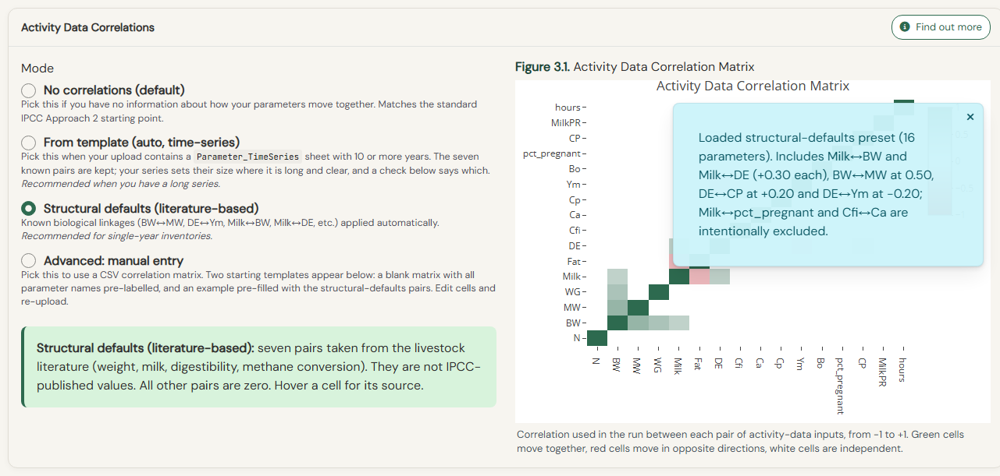{width=100%}

*Screenshot 5. The first card of Tab 3 with "Structural defaults" selected, and the matrix of the seven pairs.*

| Parameter A | Parameter B | Correlation | Reason, in short |
|---|---|---|---|
| BW | MW | +0.50 | Larger breeds are heavier at every age and have a larger mature weight. |
| BW | WG | +0.40 | Well-fed animals are both heavier and gain weight faster. |
| Milk | Fat | -0.30 | As milk yield rises, the fat percentage falls (dilution). |
| Milk | BW | +0.30 | Larger dairy breeds and more intensive systems have heavier cows and higher yields. |
| Milk | DE | +0.30 | More digestible feed supports higher milk yield. |
| DE | CP | +0.20 | Within one forage, digestibility and protein fall together as the plant matures. |
| DE | Ym | -0.20 | The IPCC assigns a lower methane conversion factor to more digestible diets. |

All other pairs are zero. Four values can reasonably be changed through the manual matrix when you know your situation: BW and MW 0.8 to 0.9 when both weights come from the same survey; Milk and BW 0.10 to 0.20 for a single-breed herd; DE and CP 0.3 to 0.5 when your feed-quality uncertainty is mainly about forage maturity; DE and Ym -0.3 to -0.5 for high-grain dairy or feedlot systems.

## Animal numbers: where do they come from?

The last card on Tab 3 asks about your animal numbers (Screenshot 6). The questions all come back to one idea: if one number is wrong, which other numbers are wrong with it?

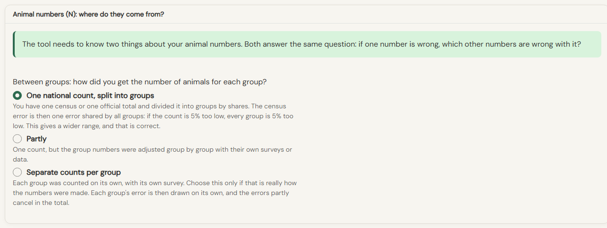{width=100%}

*Screenshot 6. The "Animal numbers" card in a single-year run: one question, about the groups.*

**Between groups (single year and trend).** How did you get the number of animals for each group?

- **One national count, split into groups.** You have one census or one official total and divided it into groups by shares. The tool then treats the census error as one error shared by all groups: if the count is 5% too low, every group is 5% too low. The range is wider, and that is correct.
- **Partly.** One count, but the group numbers were adjusted group by group with their own surveys or data.
- **Separate counts per group.** Each group was counted on its own. Choose this only if that is really how the numbers were made. Each group's error is then drawn on its own, and the errors partly cancel in the total.

In a trend run, the same card asks two more questions (Screenshot 7).

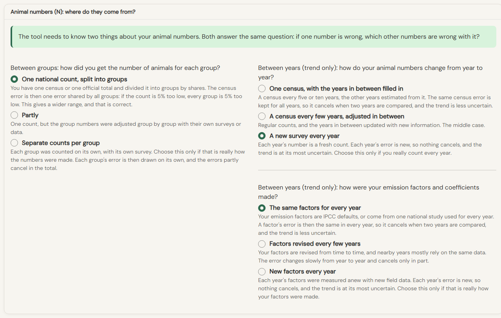{width=100%}

*Screenshot 7. The same card in a trend run, with the questions about the years.*

**Animal numbers between years (trend only).** How do your animal numbers change from year to year?

- **One census, with the years in between filled in.** A census every five or ten years, the other years estimated from it. The same census error is kept for all years, so it cancels when two years are compared, and the trend is less uncertain.
- **A census every few years, adjusted in between.** The middle case.
- **A new survey every year.** Each year's number is a fresh count. Nothing cancels, and the trend is at its most uncertain. Choose this only if you really count every year.

**Emission factors and coefficients between years (trend only).** How do the IPCC coefficients (Cfi, Ca, Ym, Bo, MCF, EF3, EF4, EF5 and so on) move from one year to the next?

- **The same factors for every year.** Your emission factors are IPCC defaults, or come from one national study used for every year. A factor's error is then the same in every year, so it cancels when two years are compared, and the trend is less uncertain.
- **Factors revised every few years.** Your factors are revised from time to time, and nearby years mostly rely on the same data. The error changes slowly from year to year and cancels only in part.
- **New factors every year.** Each year's factors were measured anew with new field data. Each year's error is new, so nothing cancels, and the trend is at its most uncertain. Choose this only if that is really how your factors were made.

Why does this matter so much for a trend? Suppose your country uses the same emission factors for the whole time series. Then a draw with a high Ym in the base year should also have a high Ym in the current year. When the two years are compared, this coefficient uncertainty cancels out, and the uncertainty of the trend comes only from the changes in activity data. The IPCC (Volume 1, Chapter 3, section 3.2.3) calls this a "Type A" sensitivity. Treating the factors as independent from year to year would make the trend look much more uncertain than it is.

What changes: the question about groups changes the uncertainty of each year's total; the questions about years change the uncertainty of the trend; none of them changes the mean. On the same tested inventory, in trend mode, the 95% range of the trend was about ±70 points with a new survey every year and about ±3 points with one census interpolated, with the coefficients fully correlated between years.

A practical check for a trend: run it once with "The same factors for every year" and once with "New factors every year". If the two trend uncertainties are similar, your result does not depend on this choice. If they are very different, the emission factors dominate your trend uncertainty, and your inventory report should say which assumption you used.

In the tornado chart, a count split into groups appears as one bar, for example "N (one count, 27 groups)", because the groups move together.

Put one sentence in your inventory report, for example: "Animal numbers come from the 2017 livestock census, split by production system using survey shares, and extrapolated to other years with regional growth rates. The uncertainty analysis treats the census error as common to all groups and all years."

\newpage

# Running the simulation (Tab 4: Simulate)

## Settings

Before you click Run, a few settings need your attention (Screenshot 8).

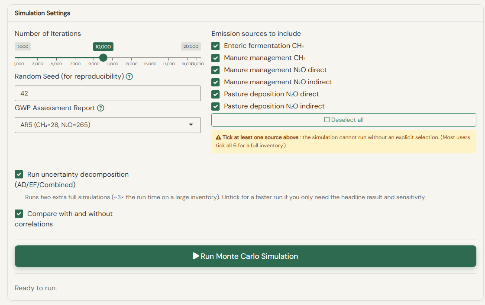{width=100%}

*Screenshot 8. The settings of a single-year run.*

**Number of iterations.** How many times the tool draws a full set of inputs and recalculates the emissions.

- 1,000: a quick test, to check that everything runs. Do not use it for reporting.
- 10,000: the minimum for reporting. The ends of the interval (the 2.5th and 97.5th percentiles) are stable.

**Random seed.** A Monte Carlo simulation works with random draws, so if nothing fixed them, every run would give slightly different numbers, even with the same file and the same settings. The seed is the starting point of the random draws. With the same file, the same settings and the same seed, you get exactly the same results every time. This is very important for your inventory: a reviewer, a colleague or you yourself next year can re-run the analysis and find the same figures. Keep the seed (42 by default) and write it down in your report. To check that your results do not depend on luck, you can run once with another seed: the margin of error should move by only a few tenths of a percentage point.

**GWP version.** The global warming potentials used to convert methane and nitrous oxide into CO~2~ equivalent. Choose AR4 (CH~4~ = 25, N~2~O = 298), AR5 (CH~4~ = 28, N~2~O = 265) or AR6 (CH~4~ = 27, N~2~O = 273; the 27 is the value for biogenic methane, which is right for cattle). The default is AR5. Use the version your reporting guidelines require.

**Emission sources.** Tick every source that applies to your inventory ("Select all sources" ticks the six at once). A source you do not tick counts as zero. You may leave out enteric fermentation, but the enteric inputs must still be in your file, because the manure calculations use them. If enteric fermentation is not ticked, its emissions and uncertainty do not appear in the results.

**Run uncertainty decomposition (AD/EF/Combined).** Ticked by default. The tool runs two more simulations, one where only the activity data vary and one where only the emission factors and coefficients vary, to fill the AD and EF columns of Table 3.3. It roughly triples the run time on a large inventory; untick it for a quick look.

**Compare with and without correlations** (single year only). Described in the correlations chapter: the tool also runs your inventory with fewer correlation choices, so you can see the effect of each one. It is greyed out when nothing is chosen on Tab 3, because there would be nothing to compare.

**Trend runs.** In trend mode the settings show two counts instead of one: the iterations per year (2,000 by default, enough for the yearly chart and the trend line) and the draws for the base year and the reported year (10,000 by default, the same as a single-year run; these two years give the headline figures and the IPCC table). The between-year choices are on Tab 3, as described in the correlations chapter.

## Running the simulation

Click **Run Monte Carlo Simulation** (or **Run Trend Analysis** in trend mode). A progress bar shows the steps. For 10,000 iterations and one production system, a run takes 15 to 60 seconds. Inventories with many sub-categories take longer, and a trend takes longer than a single year.

When the run finishes, a short message says that the results will appear in a few seconds, and the results open on the same tab. They appear all at once when everything is ready; until then a note stands in their place.

To change a setting and run again, click **Back to settings** at the top of the results, change the setting, and click Run again. The new results replace the old ones (the previous run is removed from memory, whichever kind it was). To change your input data, distributions or correlations, go back to Tab 1, 2 or 3, make the change, then return to Tab 4 and run again.

## Convergence diagnostics

The diagnostics come first in the results. They tell you whether you ran enough iterations for the results to be stable. Click the red **Run Diagnostic** button at the top of the results to open them (Screenshot 9). Four checks are shown, then a chart:

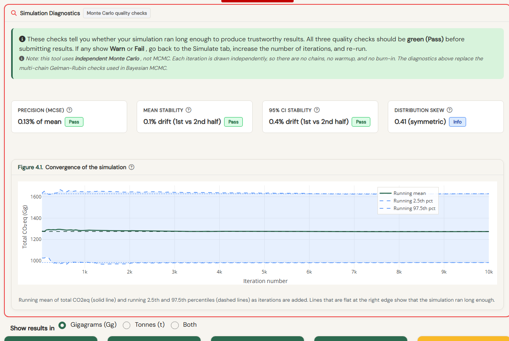{width=100%}

*Screenshot 9. The diagnostics of a 10,000-iteration run: all checks pass and the lines of the convergence chart are flat at the right.*

- **Precision (MCSE)**: the Monte Carlo standard error, as a percentage of the mean. It says how much the mean would move with another seed. Pass below 0.5%, Warn between 0.5% and 1%, Fail at 1% or more.
- **Mean stability**: how much the mean from the first half of the iterations differs from the second half. Pass below 2%.
- **95% CI stability**: how much the ends of the 95% interval move between the two halves. Pass below 5%.
- **Distribution skew**: whether the distribution of the total leans to one side. For emissions a slight lean to the right is normal; this is information, not a pass or a fail.
- **Convergence trace** (Figure 4.1): the running mean and the 95% interval plotted against the number of iterations. They should flatten out before the end of the run.

If a check shows Warn or Fail, go back to the settings, increase the number of iterations, and run again.

In a trend run, the same checks are shown twice: for the total of year t, which is the figure you report, and for the change between the base year and year t.

Note: each iteration is an independent draw. There are no chains, no warm-up and no burn-in, as there would be in other Monte Carlo methods.

\newpage

# Understanding results (Tab 4: Results)

Every graph in the tool has a number, a title and a caption. The number gives the tab and the position: Figure 4.2 is the second figure on Tab 4. (The screenshots in this guide are numbered separately, so that the two do not get mixed up.)

## Single-year results

**Units.** Above the result cards, "Show results in" lets you choose gigagrams (Gg, with three decimals, the default), tonnes, or both. The choice applies to the cards and the line under them.

**The result cards** (Screenshot 10). Five boxes give the headline:

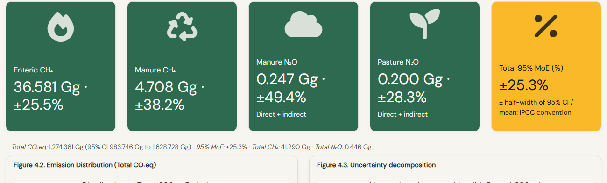{width=100%}

*Screenshot 10. The result cards and, under them, the line with the totals.*

- **Enteric CH~4~**, **Manure CH~4~**, **Manure N~2~O** and **Pasture N~2~O**: the mean emissions of each source, in tonnes or gigagrams of the gas itself, each with its own 95% margin of error. The two N~2~O boxes add the direct and the indirect emissions.
- **Total 95% MoE (%)**: the headline uncertainty. It is half the width of the 95% confidence interval, as a percentage of the mean. This is how the IPCC reports uncertainty (Volume 1, Chapter 3, Table 3.3), and it is the one uncertainty figure used everywhere in the tool.

The line under the cards gives the total in CO~2~ equivalent with its 95% confidence interval, and the totals of CH~4~ and N~2~O.

**The charts** (Screenshot 11). Figure 4.2 shows the distribution of total emissions over all the iterations: each bar counts the iterations whose total fell in that range, and the dashed lines mark the 2.5th and 97.5th percentiles, the ends of the 95% interval. Figure 4.3 appears when the decomposition was ticked: it shows the margin of error when only the activity data vary (AD), when only the emission factors and coefficients vary (EF), and when both vary (combined).

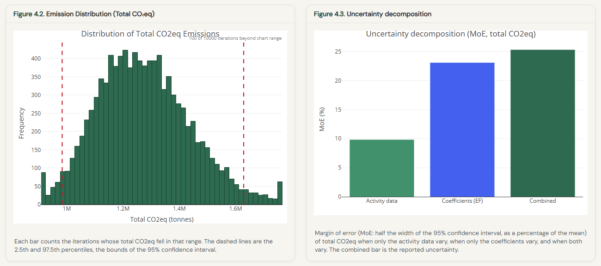{width=100%}

*Screenshot 11. Figure 4.2, the distribution of the total, and Figure 4.3, the AD and EF decomposition.*

How to read Figure 4.3: if the AD bar is the larger one, better livestock surveys would reduce the total uncertainty most. If the EF bar is the larger one, country-specific measurements of the emission factors would help more.

**The tables** (Screenshot 12). The first table gives one row per group, with the mean emissions of CH~4~, N~2~O and CO~2~ equivalent, the margin of error and the 95% interval. The list above it lets you group the rows by cattle type (the default), by production system or by sub-category. The second table gives the same results by IPCC source category (3.A.1, 3.B.1, 3.B.5, 3.D.1.c, 3.D.2), in the order of Table 3.3.

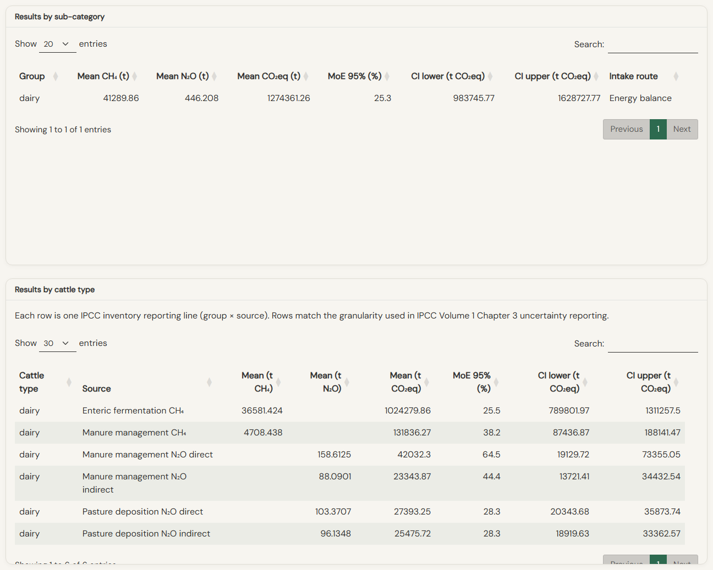{width=100%}

*Screenshot 12. The results by group and by IPCC source category.*

**The effect of correlations** (Screenshot 13). When "Compare with and without correlations" was ticked, a last chart shows one bar per correlation level for total CO~2~eq, CH~4~ and N~2~O: first with no correlations at all, then with each of your Tab 3 choices added in turn. The last bar is the run you report. The change from the previous bar is written above each bar, in percentage points. A rise means your correlations widen the uncertainty; a fall means they narrow it. Both can happen, and both are fine: the chart is there so you can explain the effect of your choices.

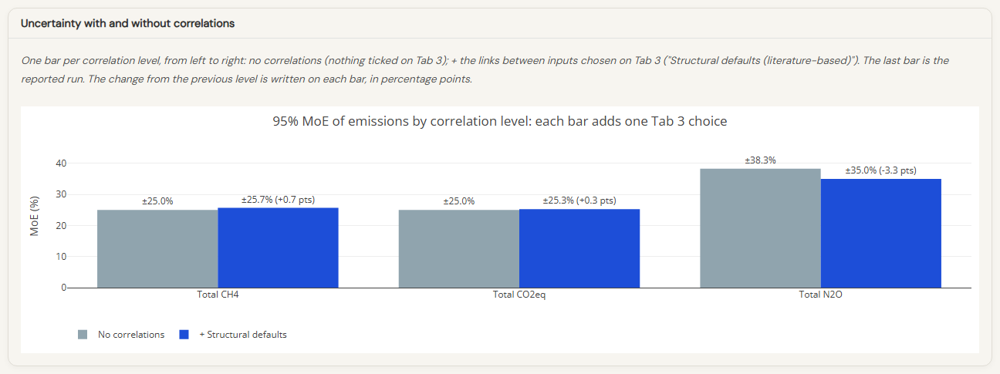{width=100%}

*Screenshot 13. The comparison for Country X: one group, so two bars, with and without the structural defaults.*

## Trend results

A trend run gives a different set of results, built around the two years the IPCC asks for.

**What to report** (Screenshot 14). The first card lets you choose the base year and the year you report (year t); by default the first and the last year of your series. Under the two lists, a few sentences say exactly what to report: the total of each year with its uncertainty, the change between them with its 95% range, and whether that range includes zero. When it includes zero, the inventory cannot tell an increase from a decrease at 95%; that is an honest and useful result.

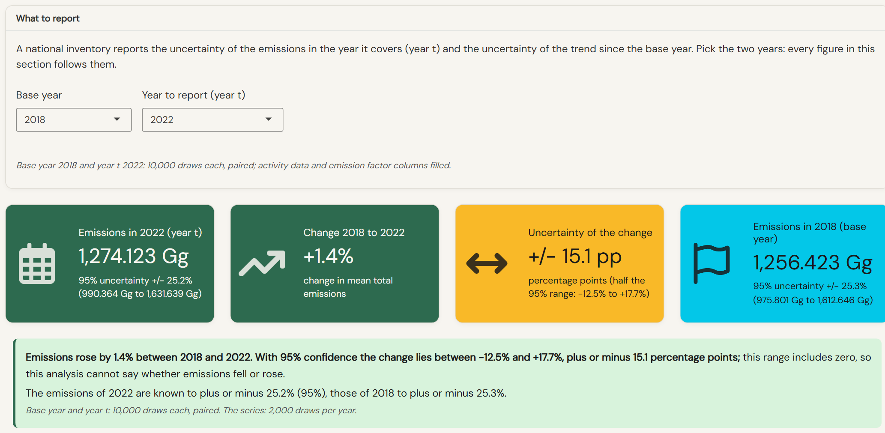{width=100%}

*Screenshot 14. The top of the trend results: the units, the two years, the sentences to report, and the four cards.*

**The cards.** Four boxes give the change since the base year (with its 95% range), the average change per year over all the years, the total of the latest year with its margin of error, and the largest change from one year to the next. The units choice above works as in a single-year run.

**The charts** (Screenshot 15). Figure 4.2 shows the total of every year with its 95% interval as a shaded band. Figure 4.3 shows the change from one year to the next, in percent. Figure 4.4 shows the distribution of the change between the first and the last year over all the iterations; when its 95% range does not include zero, the trend is distinguishable from no change.

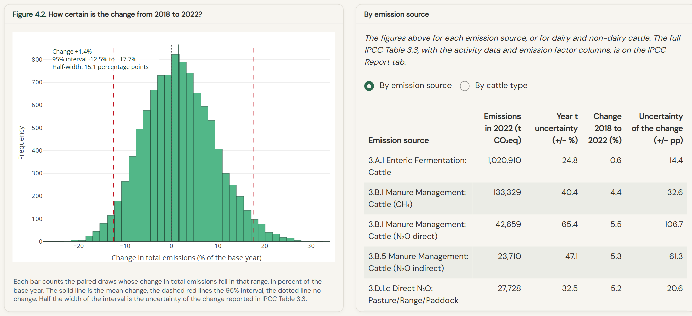{width=100%}

*Screenshot 15. The trend over the years (Figure 4.2) and the year-to-year changes (Figure 4.3).*

**The tables.** Three tables follow: the two years side by side by emission source (the mean and margin of error of each source in both years, the change between them and its range, and which sources drive the uncertainty of year t); the results by group for any year you pick; and every year, with its mean, 95% interval, margin of error and changes.

\newpage

# Sensitivity analysis (Tab 5)

The sensitivity analysis answers a very practical question: if you could improve only a few inputs, which ones would narrow the uncertainty most?

## Reading the tornado chart

The tornado chart (Figure 5.1, Screenshot 16) shows the ten inputs with the largest influence on the output you chose above it. The length of a bar is the sensitivity coefficient (SRC). A bar to the right means that a higher value of the input gives higher emissions; a bar to the left means that a higher value gives lower emissions (more digestible feed, for example, gives less methane per kilogram of feed).

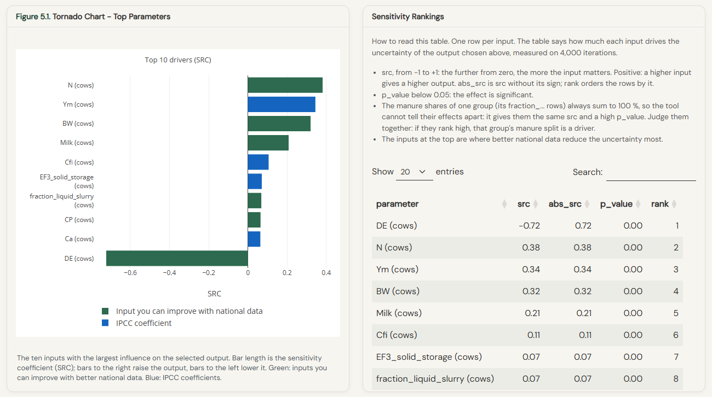{width=100%}

*Screenshot 16. The sensitivity tab for Country X: the tornado chart and the ranking table with its reading note.*

The bars have two colours:

- **Green**: inputs whose uncertainty you can reduce with better national data (surveys, measurements).
- **Blue**: IPCC coefficients, whose uncertainty you can hardly reduce with national data.

Focus your data work on the green bars at the top of the chart.

**The labels** tell you exactly which input and which group:

- "DE (cows)" or "MCF_solid_storage (cows)": one input of one group; inputs sampled per manure system carry the system in their name.
- "Ym = 7.02 (shared by 12 groups)" or "DE = 52.8 (extensive beef, 6 groups)": one value shared by several groups, drawn once (see the correlations chapter). The value is in the label because a file can hold several estimates of the same parameter, and the value tells them apart. When all the groups are in one production system, the label names it.
- "N (one count, 27 groups)": the animal numbers, when they come from one national count split into groups.

Long labels break onto two lines before the bracket, so the chart keeps its shape.

**The choices above the chart.** "Output variable" lets you rank the inputs for one emission source only (enteric CH~4~, manure CH~4~, and so on). When your inventory has several groups, a filter lets you keep only the inputs of some groups. If you ran the comparison of correlation levels, a switch lets you see the ranking without correlations too.

## Reading the ranking table

Next to the chart, the table ranks every input. A short note above it explains each column:

- **src**, from -1 to +1: the further from zero, the more the input matters. Positive means a higher input gives a higher output.
- **abs_src**: src without its sign. **rank** orders the rows by it: rank 1 is the input that matters most.
- **p_value**: below 0.05 the effect is significant, that is, not due to chance. Most rows show 0.00.
- One exception is worth knowing: the manure shares of one group (its fraction_... rows) always add up to 100%, so when one goes up another goes down. The tool cannot tell their effects apart, so it gives them the same src and a high p_value. Read them together: if they rank high, that group's manure split is a driver.

The ranking is computed on 4,000 of the iterations, which is enough for stable values (they agree within ±0.01 with a ranking on 10,000).

## Sensitivity in a trend run

A trend run gives two rankings, each with its tornado chart and its table (Screenshot 17):

- **The latest year**: what drives the uncertainty of that year's total. It reads like a single-year ranking.
- **The change between the first and the last year**: what drives the uncertainty of the trend. An input drawn in both years appears once per year, for example "N (cows) 2018" and "N (cows) 2022". An input whose error is the same in both years cancels in the change, so it drops down this ranking; that is the correlation between years at work.

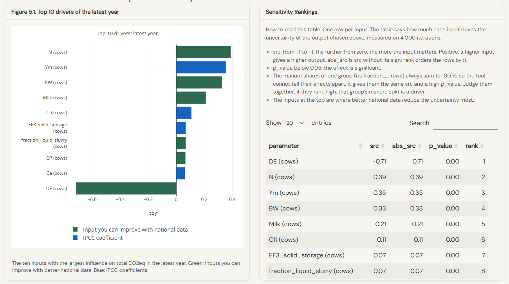{width=100%}

*Screenshot 17. The sensitivity of a trend run: the latest year, with its tornado chart and ranking table.*

\newpage

# The IPCC report and the downloads (Tab 6)

## IPCC Table 3.3 on screen

Tab 6 shows your results in the layout of IPCC Table 3.3 (Screenshot 18), and gives you the two downloads.

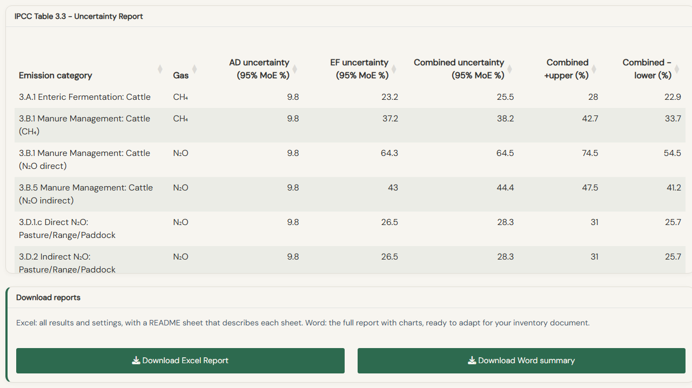{width=100%}

*Screenshot 18. The IPCC Report tab of a single-year run: Table 3.3 and the two download buttons.*

For a single year, the table has one row per emission category and the three totals. The columns are:

- **AD uncertainty**: the margin of error when only the activity data vary;
- **EF uncertainty**: the margin of error when only the emission factors and coefficients vary;
- **Combined uncertainty**: both vary; this is the figure you report;
- **Combined +upper and -lower**: the two halves of the 95% interval, which differ when the distribution leans to one side.

For the IPCC Inventory Software, copy the AD and EF columns of the matching category rows. Both are filled when the decomposition was ticked on Tab 4.

For a trend, the tab shows the sentences to report and the full trend version of Table 3.3 for the base year and year t, with the trend columns. The first and the last year are always computed with 10,000 paired draws during the run. If you choose two other years, a button appears to run them the same way.

## The downloads

Two downloads are available:

- **Excel report (.xlsx)**. The first sheet, README, describes every other sheet. For a single year: the run settings, the QA/QC checks ignored or repaired, the results (one row per IPCC reporting line: mean, 95% confidence interval, margin of error, and the activity data and emission factor split when the decomposition ran), the sensitivity ranking and every input of the run. For a trend: the run settings, the headline figures to report, IPCC Table 3.3, every year in total, by source and by group, the two sensitivity rankings and every input.
- **Word report**. A complete report you can adapt for the uncertainty section of your inventory report. It reads in the order of the work: a summary; 1. the simulation (settings and Monte Carlo diagnostics); 2. the inputs (parameters filled with defaults, placeholder ranges, checks ignored or repaired, the sampled distributions and the full input table); 3. the results (by source, IPCC Table 3.3, by group, and the effect of correlations); 4. the sensitivity analysis; 5. notes for IPCC reporting. Every figure is numbered and has a caption.

\newpage

# IPCC reporting conventions

## Where uncertainty results go in the national inventory report

The 2006 IPCC Guidelines (Volume 1, Chapter 3, section 3.3) describe what to report for Approach 2 (Monte Carlo):

1. the 95% confidence interval for each major source category and for the national total;
2. the results in the Table 3.3 format (the downloads on Tab 6 give it);
3. a description of the Monte Carlo approach: number of iterations, distributions used, correlation assumptions;
4. every parameter where a country-specific value replaced an IPCC default, with the justification.

The Methodology document on the Resources tab gives the complete technical description of the equations, the sampling and the convergence checks. You can cite it in your inventory report.

## What IPCC expert reviewers will check

From experience with IPCC expert reviews, reviewers usually look at:

- whether the uncertainty is reported at the right level of detail (for example separately for dairy and other cattle, per emission source, when the inventory reports them separately);
- whether the Table 3.3 format and column conventions are followed;
- whether the Monte Carlo approach is described well enough to be reproduced (this is where the seed and the settings sheet help);
- whether the number of iterations is enough for stable results;
- the basis for any country-specific uncertainty range that differs from the IPCC defaults.

\newpage

# Worked example: Country X (hypothetical dairy)

This example walks through the whole workflow with the Country X dataset. It takes about ten minutes, and it is the best way to get to know the tool before you use your own data.

**Step 1: Load data.** On Tab 1, choose "Single year". In the "Country / Example Data" list, pick "Country X (hypothetical dairy)". The data loads: 16 parameters for one group of dairy cows in a smallholder system. In the parameter table, note that the activity data (N, BW, Milk, WG, Fat) use normal distributions and the coefficients (Ym, DE, Bo and so on) use PERT or lognormal distributions.

**Step 2: QA/QC.** Go to Tab 2. Every parameter passes except one marked Missing: the hours of work. It is not in the example file, so the tool used the IPCC default (zero for cows). A Warn on body weight would mean the value is far from the IPCC default for that animal class; a deliberate country-specific value can be documented in the inventory report rather than corrected.

**Step 3: Correlations.** Go to Tab 3. Select "Structural defaults". (The example has only a 5-year series, so "From template" would fall back to the same seven pairs; the check under that option would say so.) Country X has one group, so the animal-numbers question does not change anything here.

**Step 4: Simulate.** Go to Tab 4. Set the iterations to 10,000, keep the seed at 42 and the GWP at AR5. Click "Select all sources". Keep the decomposition ticked, and tick "Compare with and without correlations". Click "Run Monte Carlo Simulation".

**Step 5: Results.** After a short while the results appear. Click "Run Diagnostic": all checks should pass. The total margin of error is about ±25%. The comparison shows that the structural defaults change it by less than one percentage point.

**Step 6: Sensitivity.** Go to Tab 5. The tornado chart shows which inputs drive the uncertainty. In this example the digestibility of the feed (DE) comes first, with a bar to the left (more digestible feed, less methane), followed by the number of animals (N), Ym and the body weight (BW). DE, N and BW are green: better national data on feed and herd would reduce the uncertainty most.

**Step 7: Report.** Go to Tab 6. Read Table 3.3, then download the Excel report (start with its README sheet) and the Word report for a draft of the uncertainty section.

\vspace{1cm}
\hrule
\vspace{0.3cm}
\textit{\small Funded by the Global Methane Hub.}
